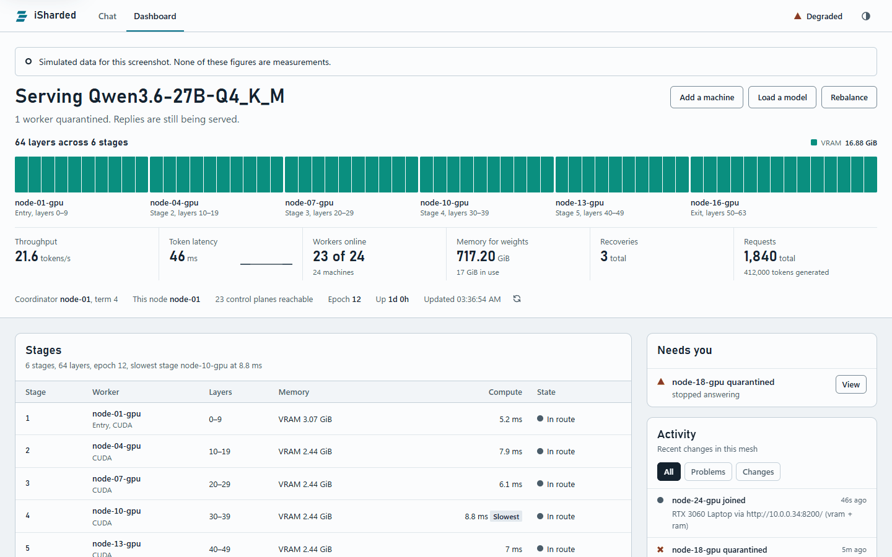

# iSharded

> iSharded is an active project, changing quickly. Commands and the network protocol can change between versions, so upgrade all of a mesh's nodes together. Nothing here should be treated as finished or production-proven yet.

iSharded runs language models across a mesh of many computers, using whatever memory each one has: VRAM, unified memory, system RAM, or disk. A model too big for any one of them can run across all of them. There is no central server. Every node runs the same software, the nodes elect one of themselves to coordinate, and any node can serve the API.

It works on a closed network, a LAN, across VLANs, over Tailscale, or between remote machines with TLS. The API follows OpenAI's, so existing clients only need a new URL and key.

It is for people and small groups who trust each other and want to pool machines to run a model none of them could hold alone. A public mesh open to anyone is not ready: a node in the route can read prompts, and [iSharded security](docs/SECURITY.md) lists what stays unanswered.

Each token crosses every machine in the route. It is built to grow to many nodes. The largest run so far is seven machines in four countries, and [Scaling to many nodes](docs/GUIDE.md#scaling-to-many-nodes) separates what is proven from what comes next. iSharded's security has been reviewed by AI only, not by a person. [Current limits](docs/GUIDE.md#current-limits) says what that means for you.

<picture>
  <source media="(prefers-color-scheme: dark)" srcset="docs/screenshots/dashboard-dark.png">
  
</picture>

*The dashboard on a real pool of three local CPU workers serving Qwen3-0.6B, with sample names. [More of the console](docs/GUIDE.md#chat-page-and-dashboard).*

## Measured results

Qwen3-235B-A22B Instruct at Q5_K_M, 155 GiB and 94 layers, ran on four rented A40s in one data center in Sweden, over TLS, with the native engine and a 0.6B draft. A fifth GPU in Romania, about 40 ms away, joined for the two-country rows. A stage is one machine's share of the model. With stages overlapping, several passes are on the route at once, so every GPU has work.

| What | Result |
|---|---|
| One reply, plain decoding | 27.6 tokens/s |
| One reply, stages overlapping | 40 tokens/s |
| One reply across two countries, plain | 11.6 tokens/s |
| One reply across two countries, stages overlapping | 23 tokens/s |
| First token, new prompt of about 3,400 tokens | 2.8 s, against 7.5 s with the prompt sent whole |
| Replies compared with a load with no draft | Identical, 12 of 12 |
| A stage's engine killed mid-reply | Paused 7.5 s and finished with the same text |
| A worker process killed mid-reply | Paused 41 s and finished with the same text |

After a failure, the last words of a reply can differ from an unbroken run where two tokens are nearly tied. [Measured across data centers](docs/GUIDE.md#measured-across-data-centers) has the full table and its limits.

The same model at Q8_0, 233 GiB, ran on eight rented A40s in one data center on 10 November 2026, and Qwen3.6-27B ran on four of them with many replies at once:

| What | Result |
|---|---|
| 235B at Q8_0 across eight A40s, one reply, plain decoding | 18.4 tokens/s |
| The same, stages overlapping | 29.3 tokens/s |
| The same, 8 replies at once | 92 tokens/s in all |
| 27B across four A40s, 16 replies at once | 167 to 172 tokens/s in all, against 100 to 115 before a stage's replies shared one cache |
| 27B across four A40s, 4 replies at once | 95 tokens/s in all, each reply as fast as one alone |

The 235B rows and the 4-reply row were measured on the version before this one. This version changes when a stage waits to run several replies in one pass, and those changes have unit tests but no measurement on rented GPUs yet. [Test results](docs/RESULTS.md) holds every speed, failure and security result measured so far, each with its setup, and what has not been measured yet.

## What it does

- Starts with one command, and adds a machine with an invite code.
- Splits a model's layers across machines, each holding only its share.
- Spans memory types: one node can hold layers in VRAM, RAM, and disk at once, and nodes do not have to match.
- Runs GGUF models on stock llama.cpp, on any GPU with a Vulkan driver, and safetensors models on its own PyTorch code.
- Runs several models at once on the same mesh.
- Runs many conversations at once through one split model, with each machine working on several of them in one pass.
- Serves an OpenAI-shaped API with streaming, tool calling, and image input, plus a chat page and a live dashboard on every node.
- Gives every model a few tools of its own, which the mesh runs itself: the date and time, a calculator, and facts about the mesh.
- Speaks MCP both ways: MCP clients can use a mesh, and models on a mesh can use the tools of MCP servers.
- Keeps replies going through a crashed stage, a dead node, a dead coordinator, a silent link, or a split network.
- Runs as a network one person owns, or as one nobody owns.
- Comes with an assistant that each person runs for themselves, with a mesh as its model.

The [full list](docs/GUIDE.md#what-it-does) is in the guide.

## Install

One step, with nothing to install first and no administrator. It sets up Python, adds the native engine from the latest release, and starts a node. It leaves out PyTorch, since GGUF models never use it. Add `--full` to run safetensors models too. It offers to join a mesh it finds on your network, and ends with the chat page open.

On Windows, in PowerShell:

```powershell
irm https://raw.githubusercontent.com/AuXFire/iSharded/main/install.ps1 | iex
```

On Linux or macOS:

```bash
curl -fsSL https://raw.githubusercontent.com/AuXFire/iSharded/main/install.sh | sh
```

Or take a one-click package from the [releases](https://github.com/AuXFire/iSharded/releases): `iSharded-Setup.exe`, `iSharded.pkg`, or a `.deb`. They are not signed yet, so [Windows and macOS warn once](docs/GUIDE.md#unsigned-packages). `isharded doctor` checks the machine, and says what to fix. For options, or to install by hand, see [Install](docs/GUIDE.md#install).

## Quick start

Start a mesh on the first machine:

```bash
isharded up
```

It finds the hardware, picks an address, makes the mesh's certificates, and opens the chat page signed in as the owner, where you choose a model. Off Tailscale, the mesh uses TLS with its own certificate, so a browser warns once.

Add a machine. On the machine that made the mesh:

```bash
isharded invite
```

It prints one command to run on the new machine, with a code that works once and lasts 24 hours:

```bash
isharded up --invite CODE
```

Chat on the page that opened, at `/chat` on port 8209 of any node. The dashboard is at `/dashboard`.

To call the API instead, make a key on the machine that made the mesh. `FOLDER` is where `isharded up` keeps its files: `~/.isharded/up`, or `%LOCALAPPDATA%\iSharded\up` on Windows.

```bash
isharded key create NAME --dir FOLDER --url https://127.0.0.1:8209
```

It prints the key once. Send it to any node, where `NODE` is that node's address and `ca.pem` lets curl trust the mesh's certificate:

```bash
curl --cacert FOLDER/ca.pem https://NODE:8209/v1/chat/completions -H "Authorization: Bearer YOUR_KEY" -H "Content-Type: application/json" -d "{\"messages\":[{\"role\":\"user\",\"content\":\"Say hello.\"}],\"max_tokens\":64}"
```

On Tailscale the mesh adds no TLS, so use `http` in both commands and leave out `--cacert`. [Quick start](docs/GUIDE.md#quick-start) has the rest, and [Calling the API](docs/GUIDE.md#calling-the-api) shows the OpenAI client.

## Documentation

- [Guide](docs/GUIDE.md): how iSharded works and how to run it, with every command, setting, API route, and measured result.
- [The assistant's guide](docs/ASSISTANT.md): the personal assistant that uses a mesh as its model.
- [Operating iSharded](docs/OPERATIONS.md): running a pool day to day, with failure details and recovery.
- [iSharded security](docs/SECURITY.md): what the security model covers, and what it leaves open.
- [Test results](docs/RESULTS.md): every speed, failure, exactness and security result on record, with its setup, and what is not measured yet.

## License

iSharded is licensed under the [Apache License 2.0](LICENSE). Copyright 2026 AuXFire.

The flags in `isharded/flags.svg` come from [country-flag-icons](https://gitlab.com/catamphetamine/country-flag-icons), under the MIT license, whose text is at the top of that file. The country table in `isharded/countries.bin` is built from the delegation files published by AFRINIC, APNIC, ARIN, LACNIC, and the RIPE NCC, as fetched on 6 November 2026.
