# iSharded guide

How to install, run, configure, and understand iSharded. [The README](../README.md) is the short version.

<picture>
  <source media="(prefers-color-scheme: dark)" srcset="screenshots/dashboard-dark.png">
  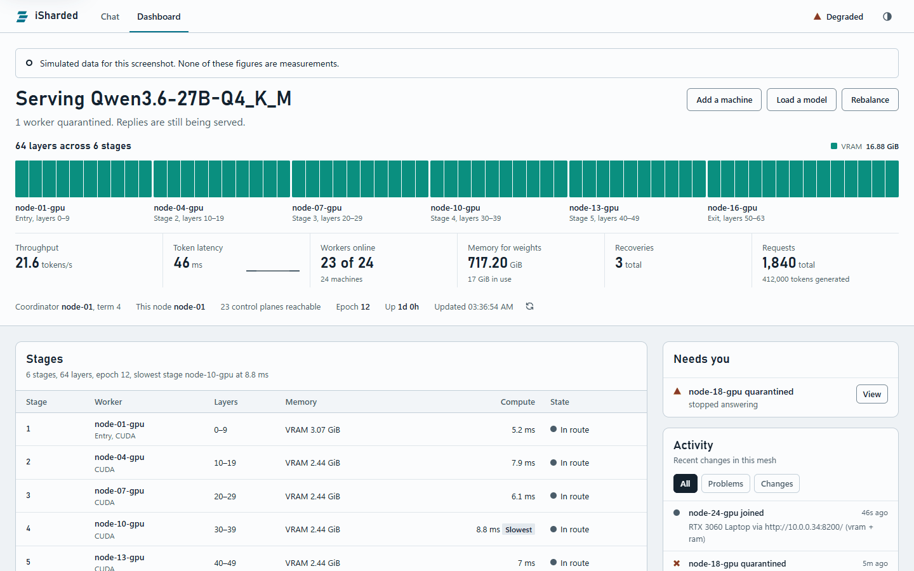
</picture>

*The dashboard on a real seven-machine mesh, serving a 235B model from VRAM alone. [More of the console](#chat-page-and-dashboard).*

## Contents

- [What it does](#what-it-does)
- [Install](#install)
- [Quick start](#quick-start)
- [How it works](#how-it-works)
- [Scaling to many nodes](#scaling-to-many-nodes)
- [Using a pool](#using-a-pool)
- [Recommended configuration](#recommended-configuration)
- [Command reference](#command-reference)
- [Environment variables](#environment-variables)
- [HTTP API](#http-api)
- [MCP](#mcp)
- [Models](#models)
- [Embeddings](#embeddings)
- [Vision](#vision)
- [The assistant](#the-assistant)
- [Memory and placement](#memory-and-placement)
- [Precision](#precision)
- [Networks and security](#networks-and-security)
- [Checking answers](#checking-answers)
- [Running a pool](#running-a-pool)
- [Troubleshooting](#troubleshooting)
- [Measured performance](#measured-performance)
- [Development](#development)
- [Current limits](#current-limits)

More detail lives in [Operating iSharded](OPERATIONS.md), [iSharded security](SECURITY.md), and [the assistant's guide](ASSISTANT.md).

## What it does

- Starts with one command, and adds a machine with an invite code. Hardware, addresses, and certificates are worked out for you.
- Splits a model's layers across machines, each holding only its share. Weights are never gathered on one machine.
- Spans memory types: one node can hold layers in VRAM, RAM, and disk at once, and nodes do not have to match.
- Uses any GPU with a Vulkan driver for GGUF models, so nodes need no CUDA or ROCm.
- Runs GGUF models on stock llama.cpp, and safetensors models on its own PyTorch code. Qwen and GPT-2 families, including mixture-of-experts models.
- Speeds up replies with a small draft model, reuses earlier conversation state, and lets conversations share a pass through each stage.
- Runs several models at once on the same mesh, and users choose between them.
- Serves OpenAI-shaped `/v1/chat/completions`, `/v1/completions`, `/v1/embeddings`, and `/v1/models`, with streaming, tool calling, and image input, plus a chat page and a live dashboard on every node.
- Speaks [Claude Messages, OpenAI Responses, and Ollama](#claude-responses-and-ollama-clients) as well, so tools built for those work against a mesh.
- Speaks MCP both ways: MCP clients can use a mesh, and models on a mesh can use the tools of MCP servers.
- Checks answers, by asking separate routes the same questions and comparing what comes back.
- Comes with an assistant that each person runs for themselves, with a mesh as its model.
- Keeps replies going through failures: a crashed stage, a dead node, a dead coordinator, a silent link, or a split network.
- Moves weights only when it must, shares them between nodes, and works with no internet at all.
- Runs as a network one person owns, or as one nobody owns, where each node decides who it accepts and what it hosts.
- Refuses to start exposed. Offers per-node certificates, signed membership, API keys with roles and rate limits, TLS, and an audit log.
- Supports planned maintenance: cordon a node and its share moves elsewhere while replies finish.
- Reports each node's disks, GPU temperature and power, load, and battery, where the machine exposes them.

## Install

One step on each platform, and you do not need Python first. These install iSharded for your user only, with no administrator, and start it.

On Windows, in PowerShell:

```powershell
irm https://raw.githubusercontent.com/AuXFire/iSharded/main/install.ps1 | iex
```

On Linux or macOS:

```bash
curl -fsSL https://raw.githubusercontent.com/AuXFire/iSharded/main/install.sh | sh
```

Or use a [one-click package](#one-click-packages). The end is the same: the node is running in the background, and the chat page is open.

### What the installers do

1. Fetch [uv](https://github.com/astral-sh/uv) at a pinned version, and check it against a pinned SHA-256. uv then provides Python 3.12 and the environment, beside the install.
2. Pick a PyTorch build. They pick a CUDA build where they find an NVIDIA GPU. They pick a CPU build on Windows without one, and on Linux with no GPU tools at all. Anywhere else they take PyTorch's default build, which on Linux is not a ROCm one. A GPU PyTorch cannot see, such as an AMD card on Windows, still works for GGUF models: the node finds it through llama.cpp's Vulkan build. See [Any GPU](#any-gpu).
3. Pick this platform's wheel from the latest GitHub Release, which has the [native engine](#the-native-engine) in it, and check it against the release's `SHA256SUMS`. A file that fails the check stops the install. There are wheels for Linux on x86_64 and aarch64 with glibc 2.28 or newer, Windows on x86_64, and macOS on Apple Silicon. Other machines get the pure wheel, which has no engine.
4. Add `isharded` to your PATH. On Linux and macOS that means a link in `~/.local/bin`, and a line in your shell's profile if that folder is not on your PATH yet.
5. On Linux, check for the one system library GGUF models need, and say how to add it if it is missing.
6. Run `isharded up --background`, which works out the address, encryption, GPU, RAM, CPU, and model folders, prints what it found, and offers to join a mesh it finds on your LAN or tailnet. Then the chat page opens, and the last lines say what to do next.

With no release yet, or no way to reach one, they fall back to the source archive. That install has no native engine, and they say so, because the fast path is then off. Run them again once a release has a wheel for your machine, or build the engine yourself. `isharded doctor` says at any time whether the engine is there, and a node without it says so in its events.

Run them again to upgrade. They stop a running node first, and start it again unless you say `--no-start`.

The Linux and macOS script takes options after `sh -s --`. The PowerShell script takes the same ones through a script block:

```bash
curl -fsSL https://raw.githubusercontent.com/AuXFire/iSharded/main/install.sh | sh -s -- --no-start
```

```powershell
& ([scriptblock]::Create((irm https://raw.githubusercontent.com/AuXFire/iSharded/main/install.ps1))) --no-start
```

| Option | What it does |
|---|---|
| `--no-start` | Install the files, and start nothing |
| `--service` | Also start this node at login, through `isharded service install` |

| Setting | What it does |
|---|---|
| `ISHARDED_INSTALL_DIR` | Where the environment goes. uv and its Python go beside it. Default: `%LOCALAPPDATA%\iSharded\venv` on Windows, `~/.isharded/app` elsewhere |
| `ISHARDED_SOURCE` | A wheel, archive, or URL to install in place of the release. Its hash is not checked, because you chose it |
| `ISHARDED_RELEASE_URL` | Where a mirror keeps a release's files, with its `SHA256SUMS`. The same checks apply |
| `ISHARDED_UV_URL` | Where a mirror keeps uv's files. The pinned hash still applies |

On a closed network, set `ISHARDED_RELEASE_URL` and `ISHARDED_UV_URL`, and uv's own `UV_PYTHON_INSTALL_MIRROR` for Python.

Antivirus that inspects HTTPS breaks tools that bring their own certificates. The installers set uv's `UV_SYSTEM_CERTS=1`, so uv trusts what this machine trusts. With `pip`, add `--use-feature=truststore` for the same effect.

### One-click packages

Each [release](https://github.com/AuXFire/iSharded/releases) has these, and each carries that release's wheel. They run the install above, so they also need the internet, for uv, Python, and PyTorch.

| Platform | File | What you get |
|---|---|---|
| Windows | `iSharded-Setup.exe` | A per-user install with no administrator. A window shows the install, and the Start Menu gets Open iSharded, Stop iSharded, and Uninstall iSharded |
| macOS on Apple Silicon | `iSharded.pkg` | `iSharded.app` in Applications, which needs your password as any package there does. The install then runs for you in Terminal. Opening the app starts the node if it is stopped, and opens the chat page |
| Debian and Ubuntu | `isharded_VERSION_amd64.deb`, `isharded_VERSION_arm64.deb` | Install with `sudo apt install ./isharded_VERSION_amd64.deb`, which installs iSharded for you and starts it. Anyone else on the machine gets their own install the first time they run `isharded`, and the applications menu gets iSharded |

The Windows installer offers two choices, both off unless you tick them. One starts the node when you log in. The other adds Windows Firewall rules so other machines on a private network can reach this node. Only that one asks for an administrator. You do not need it over Tailscale. It opens TCP ports 8200 to 8209 and those of the lanes, and UDP port 8208 for the search for a mesh, to any program on this machine. It also opens the ports direct links use, TCP 49152 to 65535, for this install's Python only. The rules cover private and domain networks, not public ones, and assume the default ports. See `packaging/windows/firewall.ps1`.

`packaging/homebrew/isharded.rb` is a Homebrew cask, and each release publishes it filled in as `isharded.rb`. Homebrew reads casks from a tap, and the project does not have one yet, so copy that file into a tap of your own: `brew tap-new NAME/isharded`, then copy it to `Casks/` in the folder that `brew --repository NAME/isharded` names, then `brew install --cask NAME/isharded/isharded`.

### Unsigned packages

The packages are not signed yet, because the project has no signing certificates, so each system warns once.

On Windows, SmartScreen says "Windows protected your PC". Choose **More info**, then **Run anyway**. Ticking the firewall choice shows an administrator prompt that names an unknown publisher.

On macOS, Gatekeeper refuses `iSharded.pkg`, saying Apple could not verify it or that it is from an unidentified developer. Choose **Done**, open **System Settings**, then **Privacy & Security**, scroll to **Security**, and choose **Open Anyway**. The same is done in Terminal with `xattr -d com.apple.quarantine iSharded.pkg`.

Check any package against the release's `SHA256SUMS` first. That shows it is the file the release built, which is what a signature would otherwise tell you.

### Removing it

Run `isharded stop`, then `isharded service remove` if you set that up. On Windows, Uninstall iSharded does both, and removes the firewall rules, which asks for an administrator if you added them. Elsewhere, remove the package if you used one, then delete `~/.isharded/app`, `~/.isharded/python`, `~/.isharded/uv`, and the link `~/.local/bin/isharded`.

The mesh's folder stays, in `%LOCALAPPDATA%\iSharded\up` or `~/.isharded/up`. It holds the mesh's keys, so delete it yourself, and only if you are done with that mesh.

### By hand

You need PyTorch built for your hardware. Install PyTorch first, because the default package may not match your GPU. See [pytorch.org](https://pytorch.org/get-started/locally/) for CUDA, ROCm, and CPU builds.

```bash
git clone https://github.com/AuXFire/iSharded.git
```

```bash
cd iSharded
```

```bash
python -m pip install -e .
```

The `test` extra adds what the test suite needs.

This installs `isharded`, `isharded-node`, `isharded-orchestrator`, and `isharded-worker`. From a checkout with the dependencies in place, `python -m isharded` works the same way without installing.

For GGUF models, nodes download a pinned, hash-checked llama.cpp build for their hardware to `%LOCALAPPDATA%\iSharded\llama` on Windows or `~/.cache/isharded/llama` elsewhere. On a minimal Linux install, add the one system library it needs with `sudo apt-get install libgomp1`. On a closed network, give each node a build with `--llama-dir`.

On a machine where antivirus intercepts HTTPS, `pip` may fail with a certificate error. Add `--use-feature=truststore` so it uses the system's trusted certificates.

A release is built by `.github/workflows/release.yml`, on a tag `v*` or by hand. `python scripts/build_wheel.py` makes the pure wheel, and `python scripts/build_wheel.py --target x86_64-unknown-linux-gnu` one with the engine in it. Linux targets need `cargo-zigbuild` and `zig`, which link against glibc 2.28 from any machine, and the build fails if the library asks for anything newer. `--library` takes an engine already built.

## Quick start

### Start a mesh

On the first machine:

```bash
isharded up
```

That is all it needs. It finds the hardware, picks an address, makes the mesh's certificates, and opens the chat page signed in as the owner, where you choose a model. Running it again starts the same node with the same settings, so only `--model` and `--no-browser` count after the first run.

To load a model as well, run `isharded up --model NAME`. It says when the model is ready, or why it could not load. On a CPU-only node with Qwen3-0.6B, it said it was up at 17 s and the model was ready at 25 s, then answered a chat.

### Add a machine

On the machine that made the mesh:

```bash
isharded invite
```

It prints one command to run on the new machine, with a code that works once and lasts 24 hours. The dashboard's "Add a machine" button does the same. The new machine makes its own key, proves it holds the code, and gets a certificate signed by the owner's machine, which has to be running at that moment. Nothing needs copying. Run `isharded up --invite CODE` on as many machines as you invite.

The new machine gets its own key for the chat page, with the user role. The owner's key stays the only admin key.

Or skip the code. A new machine running `isharded up` looks for a mesh on its LAN and its tailnet, and offers to join what it finds. The machine then waits for someone to approve it, on the dashboard or with `isharded approve NAME`, and both sides show the same key fingerprint to check. If a firewall blocks the search, which uses UDP port 8208 on a LAN, use an invite.

### What it works out

| Setting | How `isharded up` decides |
|---|---|
| Address | Tailscale if this machine has it, otherwise the LAN |
| Encryption | None added on Tailscale, which encrypts already. Otherwise TLS with the mesh's own certificate, so a browser warns once. `--trusted-network` skips it |
| GPU, RAM, CPU | Every accelerator, a share of free RAM, and half the cores |
| Models on disk | LM Studio's folders and `~/models`, so nothing downloads twice |
| Name | This machine's name |

Everything it decides is in `settings.json` in its folder, `%LOCALAPPDATA%\iSharded\up` on Windows or `~/.isharded/up` elsewhere. That folder also holds the mesh's authority key on the owner's machine, so keep it safe. To start a node at login, run `isharded service install`.

The rest of this section sets things up by hand, which gives you every option in the [command reference](#command-reference).

### One machine

```bash
python -m isharded demo --workers 2
```

This starts a control plane on port 8000 and two workers on ports 8100 and 8101, then loads `distilbert/distilgpt2` across them. Open [http://127.0.0.1:8000/chat](http://127.0.0.1:8000/chat) to chat, or [http://127.0.0.1:8000/dashboard](http://127.0.0.1:8000/dashboard) to watch it work.

With no network at all, build a tiny test model first:

```bash
python scripts/build_tiny_model.py .smoke-model
```

```bash
python -m isharded demo --workers 2 --model .smoke-model --device cpu
```

That model is random, so its output means nothing. It proves that sharded and unsharded runs agree.

### Several machines on Tailscale

Tailscale encrypts the link, so a shared token is enough here. On the first machine, make the pool's credentials:

```bash
isharded pool init --dir pool-secrets
```

Copy `pool-secrets/pool.token` to `%LOCALAPPDATA%\iSharded\pool.token` on each Windows machine, or `~/.isharded/pool.token` elsewhere. Anyone holding it has full control of the pool. Then start the first node:

```bash
isharded node --node-id node-a --gguf-dir D:\models --weights-ram-gb auto
```

It prints the address it advertises, and its control plane listens on port 8209. Start each further node the same way, naming any node already running:

```bash
isharded node --node-id node-b --join http://100.64.0.1:8209 --weights-ram-gb auto
```

Load a model from either machine. The `--url` matters, because `load` otherwise assumes the demo's port:

```bash
isharded load "unsloth/Qwen3.6-27B-GGUF:Qwen3.6-27B-Q4_K_M.gguf" --url http://100.64.0.1:8209
```

Open `http://100.64.0.1:8209/chat` and enter the token. A file already in a `--gguf-dir` folder is read locally, and a node without it reads only its share from the node that has it.

### A pool with certificates

Certificates give each node its own identity, so one can be thrown out without touching the others. On your own machine, which keeps the authority key:

```bash
isharded pool init --dir pool-secrets
```

```bash
isharded key create root --role admin --file access.json
```

```bash
isharded pool add-node --dir pool-secrets node-a --address 100.64.0.1
```

The second command prints an admin key, once. Copy `ca.pem`, `node-a.pem`, `node-a.key`, and `access.json` to node-a, and keep `ca.key` where it is. Start the node:

```bash
isharded node --node-id node-a --ca-file ca.pem --identity-cert node-a.pem --identity-key node-a.key --keys-file access.json
```

Other nodes ask to join, which keeps their private keys on their own machines:

```bash
isharded pool request-join node-b --dir node-identity --address 100.64.0.2 --url http://100.64.0.1:8209 --wait
```

```bash
isharded pool requests --url http://100.64.0.1:8209 --token YOUR_ADMIN_KEY
```

```bash
isharded pool approve node-b --dir pool-secrets --url http://100.64.0.1:8209 --token YOUR_ADMIN_KEY
```

Check the fingerprint with whoever is asking before you approve. Once approved, the waiting command saves the certificate. Start that node with its own files and `--join http://100.64.0.1:8209`.

With certificates, the pool token stops working. Use your admin key, in the chat page and with `--token` on commands.

## How it works

The diagrams use the same line colors throughout: solid blue-green for a reply's data, dashed violet for control messages, and pink for anything signed by the owner.

These diagrams show what is built. Measured figures come from the two-machine test pool unless they say otherwise.

### Two networks in one

Every node runs the same software. Control messages spread between all nodes, while a reply's data runs in a line through the stages.

<picture>
  <source media="(prefers-color-scheme: dark)" srcset="diagrams/structure-dark.png">
  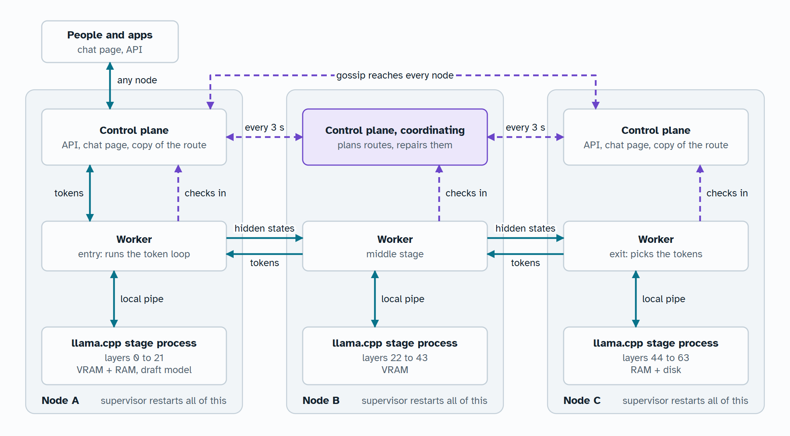
</picture>

Layers are split by what each machine can hold, so one model can span a GPU on one node and RAM and disk on another. On the test pool, a laptop RTX 3060 holds layers 0 to 7 and a desktop RX 7900 XT holds layers 8 to 63, over Tailscale. Workers check in with every control plane, so any of them can take over.

### One reply, from message to text

The node you ask runs your reply itself. The coordinator isn't involved, so losing it doesn't interrupt anything.

<picture>
  <source media="(prefers-color-scheme: dark)" srcset="diagrams/reply-dark.png">
  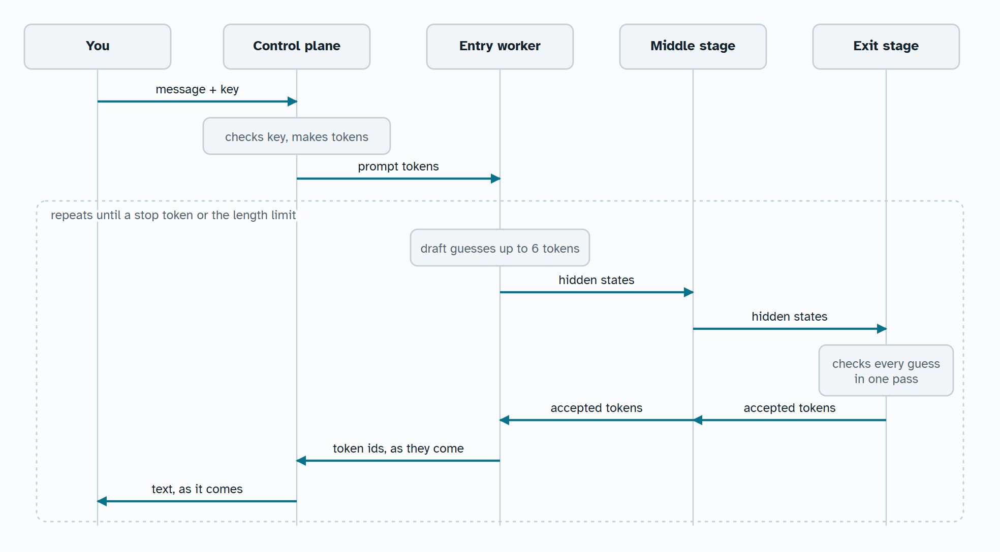
</picture>

Only hidden states and tokens cross the network during a reply, never weights. A token has to cross every stage in turn, so one reply alone would leave all but one stage idle. A small draft model keeps them busy by guessing ahead, and a long prompt goes out in parts so every stage reads at once. Conversations sharing a stage also share a pass when they can, which took four conversations from 12 to 32 tok/s on one stage.

With the [native engine](#the-native-engine), a pass moves from stage to stage over direct links without touching Python.

### The native engine

The engine is a Rust library loaded into each stage process. It runs the passes that happen for every token: a stage hands a pass on without waiting, and the last stage sends the answer straight back to the entry over a closing link. Links use TLS 1.3 with certificates pinned through the control plane, and a key for each route.

The installers put it in place on Linux, Windows, and Apple Silicon, from a release's wheel. To build it yourself, with [Rust](https://rustup.rs) installed, run this. It lands in `isharded/native`, where the package finds it:

```bash
python scripts/build_engine.py
```

`--target` builds for one of the release's targets. iSharded runs without it, over the slower Python path, and any failure on a direct link falls back to the recovery the Python path already has. Prompts, restored states, and images stay on the Python path. On the laptop test, three stages of Qwen3-0.6B went from 47.5 to 128.6 tokens/s with identical replies.

Each worker reports the engine's numbers in `runtime.telemetry.ring`. `link_rtt_us` is the average heartbeat round trip to the next stage. `hop_us` is the average from a pass leaving for the next stage to its acknowledgement coming back, so it carries a real row and shows what the row's size costs. The next stage acknowledges before it computes, so its work is not in that time. Both read zero at the last stage, which has no next stage.

### Any node can coordinate

Nodes agree on a coordinator without voting: they all apply the same rule to the same member list.

<picture>
  <source media="(prefers-color-scheme: dark)" srcset="diagrams/coordinating-dark.png">
  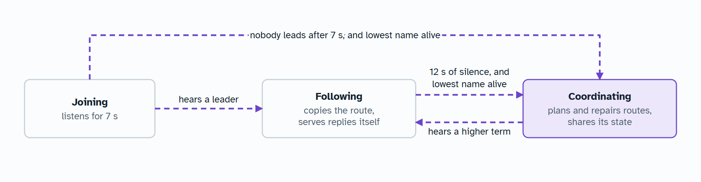
</picture>

The term only goes up, and the higher term wins, so two coordinators from a split settle themselves when they reconnect. Workers obey only the highest term they have seen.

### Loading a model

Replies keep running through the old layout until the new one is ready, and only then do they switch.

<picture>
  <source media="(prefers-color-scheme: dark)" srcset="diagrams/loading-dark.png">
  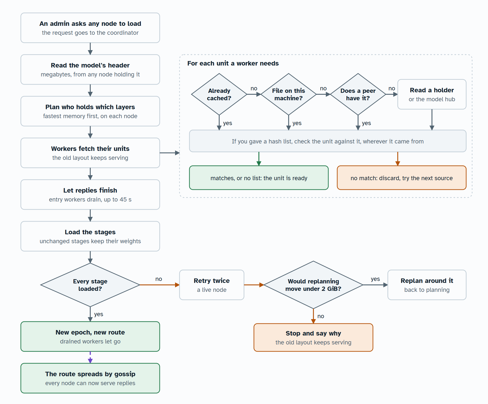
</picture>

A closed network works the same way: a GGUF file on one node is enough, and the others read the parts they need from it. The 2 GiB limit applies to a node that is alive but failed to load. If a node has died, the pool replans whatever that moves.

### What happens when something fails

The rule is that a failure must not drop a reply, and weights move only when they must.

<picture>
  <source media="(prefers-color-scheme: dark)" srcset="diagrams/failures-dark.png">
  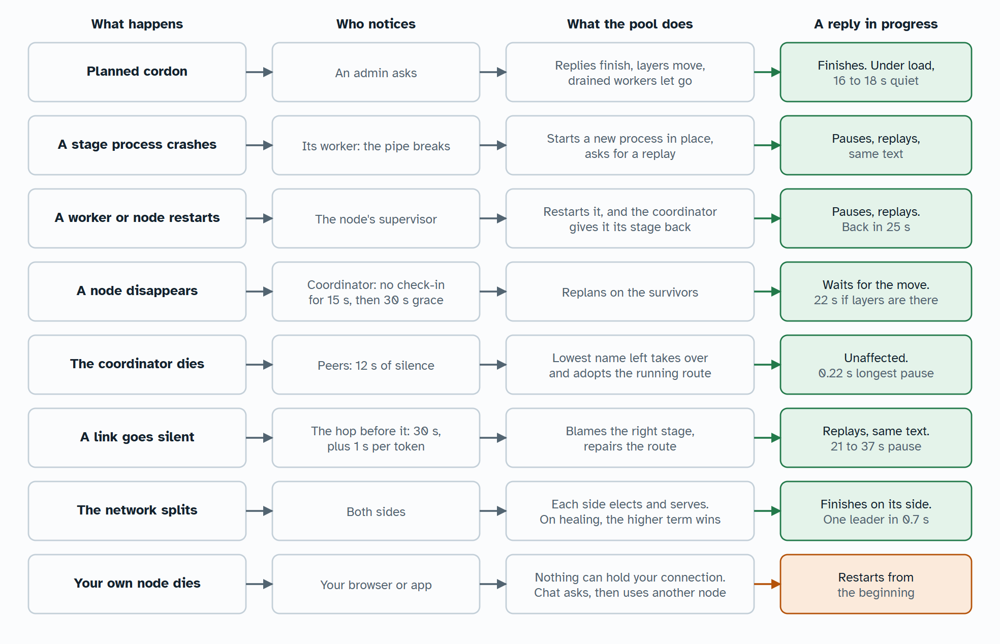
</picture>

Times are measured on the test pool, except the stage crash, measured on a small model. In the last soak test, 405 replies finished and none were lost while processes were killed on both machines for 21 minutes. [Operating iSharded](OPERATIONS.md) has the details.

### Joining an owned network

A node makes its own key and asks to join through any member. The owner approves it from their own machine.

<picture>
  <source media="(prefers-color-scheme: dark)" srcset="diagrams/joining-dark.png">
  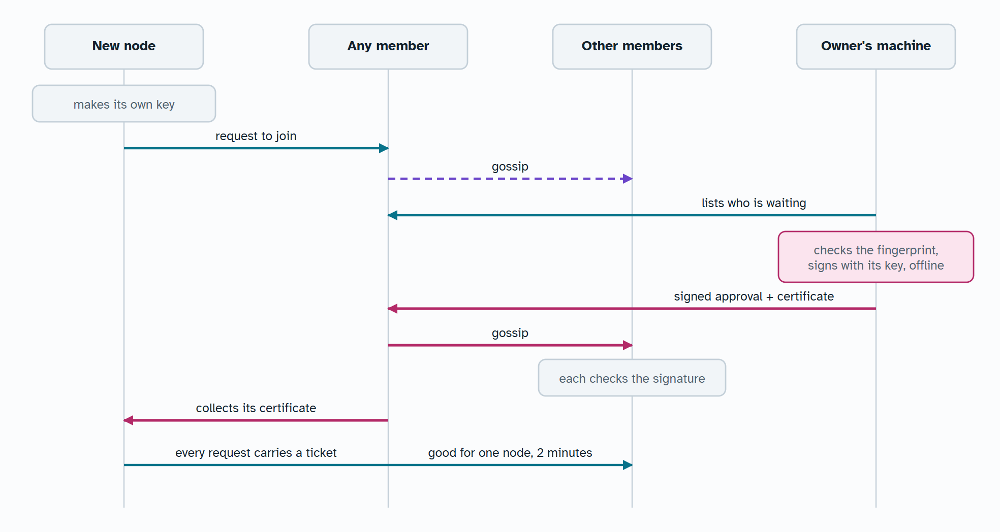
</picture>

Asking grants nothing. The new node's private key never leaves it, and the owner's key never touches the network, so a compromised node can't add a key or revoke a peer. Tickets prove a node's name without TLS, so antivirus that intercepts TLS can't break them. The link still needs Tailscale or another private network, because tickets don't encrypt anything. [iSharded security](SECURITY.md) has the commands.

### Owned or ownerless

An owned network runs without a central server, but one person decides who belongs. Removing the owner removes the signing arrows, and everything they did is done another way. Both kinds work for private or public networks.

<picture>
  <source media="(prefers-color-scheme: dark)" srcset="diagrams/ownership-dark.png">
  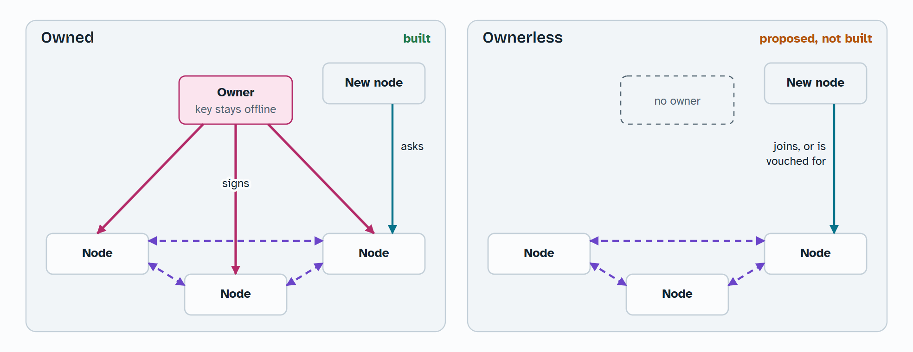
</picture>

| Question | Owned | Ownerless |
|---|---|---|
| Who lets a node in? | The owner approves it | Each node decides: anyone, or nodes vouched for by those it already accepts |
| Who removes a node? | The owner, for everyone | Nobody can. Each node blocks whoever it chooses, for itself |
| Who picks the models? | The owner, or anyone with an admin key | Anyone can propose one beside what runs. Each node chooses what it hosts, and users pick from what's running |
| What is still unsolved? | A member can read prompts. Wrong answers can be [caught](#checking-answers), not prevented | The same, plus one person could run thousands of nodes |

See [A network nobody owns](#a-network-nobody-owns) to run one. To redraw these diagrams, run `python scripts/build_diagrams.py`.

## Scaling to many nodes

iSharded is meant to run on many machines. Seven is the most it has run on so far. Every node runs the same software, any node can coordinate, and a new node joins by naming any node already running, so nothing in how a mesh forms stops at seven.

What more nodes give you:

| More nodes give you | How | Status |
|---|---|---|
| Bigger models | Each node holds only its share, so the limit is the mesh's total memory | Built |
| More models at once | Each model runs in its own [lane](#several-models-at-once) | Built |
| Survival | Any node can coordinate, serve the API, or take over a lost stage | Built, tested on seven machines |
| More replies at once | Several routes for one model, across separate groups of nodes | Next |
| A faster single reply | It does not: every token crosses every stage, so a longer route is a slower one | Keep routes short with `--placement compact` |

So a large mesh should run many short routes side by side, not one long one. That is the direction, and these are the parts that stop it getting there today:

| What stops it | Today | Where it needs to go |
|---|---|---|
| Gossip | Every node contacts every other every 3 s, so messages grow with the square of the node count | Contact a few peers per round, with liveness spreading through them |
| Worker check-ins | Each worker checks in with every control plane every 5 s | Check in with a few, and let gossip carry the rest |
| Routes | One route per lane, so one model's capacity is one route's | Several routes per model, with requests spread across them |
| Placement | Every pair of workers is timed before a load, for up to 30 s, and routes follow those times | Time a sample of neighbours once a mesh is too large to time every pair |
| Splits | Each side of a split elects a coordinator | With three or more nodes, let only the majority side coordinate |
| Memory | A lane's share is fixed when it starts | Share memory between lanes as load changes |

None of this has been measured past seven machines. If you have spare machines, running a node is the most useful test you can give it.

### Measured across data centers

Qwen3-235B-A22B Instruct at Q5_K_M, 155 GiB and 94 layers, ran on four rented A40s in one data center in Sweden, over TLS, with the native engine and a 0.6B draft. A fifth GPU in Romania, about 40 ms away, joined for the two-country rows.

| What | Result |
|---|---|
| One reply, plain decoding | 27.6 tokens/s, 36 ms a token |
| One reply with stages overlapping | 40 tokens/s, 25 ms a token |
| The same with very predictable text, counting to 150 | 82 tokens/s |
| One reply across two countries, plain | 11.6 tokens/s |
| One reply across two countries, stages overlapping | 23 tokens/s |
| Eight replies at `--parallel 4` | 62 tokens/s in all |
| First token, new short prompt | 0.4 s in one data center, 1.1 s across two countries |
| First token, new prompt of about 3,400 tokens | 2.8 s, against 7.5 s with the prompt sent whole |
| First token, a prompt seen before | 0.4 s |
| A stage's engine killed mid-reply | The reply paused 7.5 s and finished with the same text, on the same layout |
| A worker process killed mid-reply | The reply paused 41 s and finished with the same text, on the same layout |
| A stage's engine killed while reading a long prompt | First token after 13 s, with the same text |

The four stages take about 33 ms a token between them, so one machine holding the whole model and decoding plainly would reach about 30 tokens/s. That figure comes from the stages' measured compute, since no single A40 can hold this model. Overlapping stages beats it, because a route has four GPUs working and one machine has one. See [Speculative decoding](#speculative-decoding) for how they overlap.

Replies came out identical to a load with no draft: 12 of 12 across greedy and seeded sampling at temperatures 0.8 and 1.0.

Three limits showed here:

- The draft costs about 11 ms a guess on the entry's GPU, and that now sets the pace. A wrong guess costs a full trip along the route, and about 4 guesses in 10 were wrong on open-ended prose.
- A kill during a reply replayed what was already written as one batched pass, which rounded slightly differently. So after a failure the last words of a reply could differ from an unbroken run, where two tokens were nearly tied. Nothing was lost and nothing already sent changed. A reply now resumes one row at a time, which settles this on small local stages. See [Current limits](#current-limits). It has not been run again on this mesh.
- Moving a layer boundary changes where prompt rows round to BF16, so two different layouts can give different replies at near-ties. The same layout repeats exactly.

An earlier mesh of seven machines on the Python path, in four countries and two homes behind relays, ran the Q6_K build at 1.26 tokens/s. Its hops cost a full round trip plus about 10 ms, because each stage waited on the next. Stages no longer wait, but a relay still adds its own latency, so the planner keeps slow links out of the route when the model fits without them.

## Using a pool

### Chat page and dashboard

Every node serves a chat page at `/chat` and a console at `/dashboard`. The chat page below and the dashboard at the top of this page are from the [seven-machine mesh](#measured-across-data-centers). Their speed estimates are the planner's, from before it used measured links, so go by the measured figures in that section.

<picture>
  <source media="(prefers-color-scheme: dark)" srcset="screenshots/chat-dark.png">
  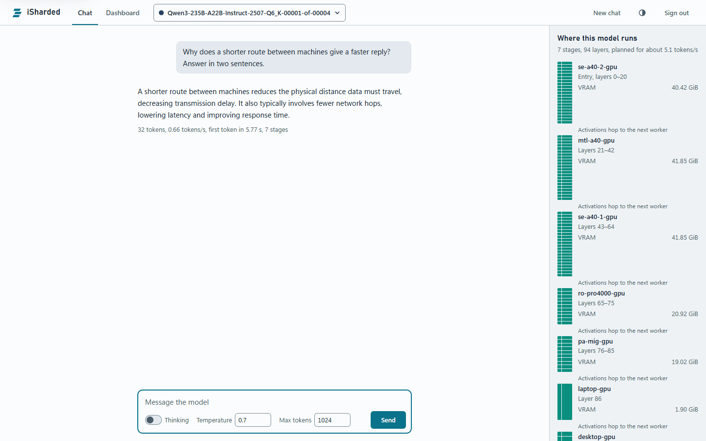
</picture>

The console is built to stay readable at 60 workers, grouping them by state so what needs you comes first. No mesh this size has run yet, so this view uses simulated data:

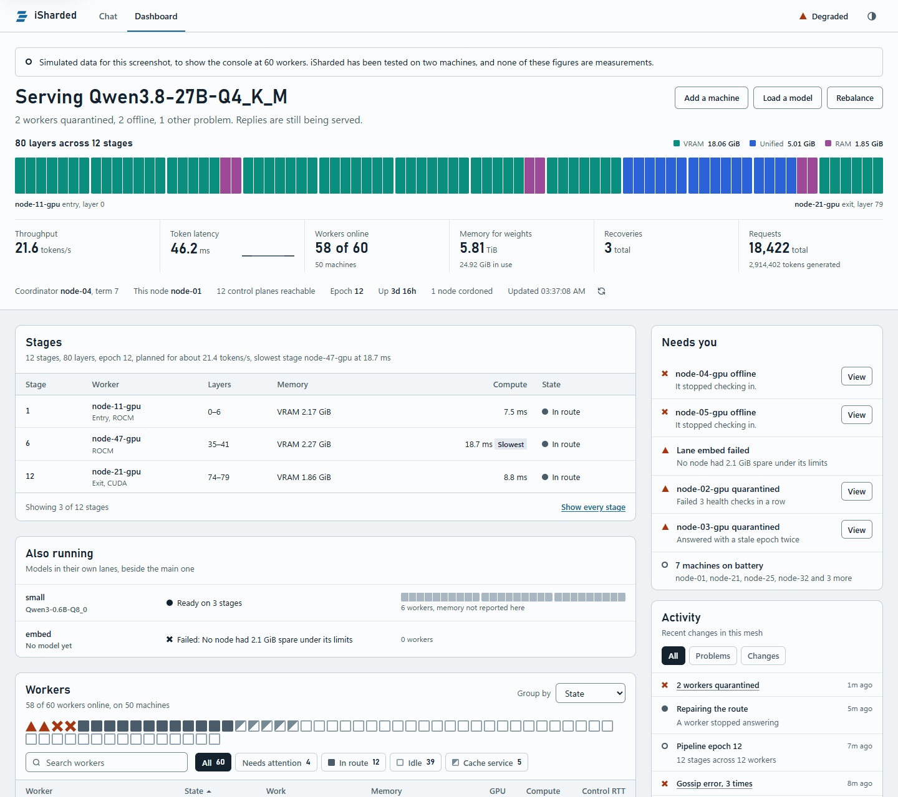


Every node serves both, so any node's address works.

| Page | What it shows |
|---|---|
| `/chat` | A chat window. It asks for a key, shows where a model would run and how fast before anything downloads, and colors each layer by the memory holding it. |
| `/dashboard` | The active pipeline, each node's state and hardware, latency, throughput, memory, recoveries, and events. Click a stage or worker for detail. |

If the node serving your chat dies mid-reply, the page asks before sending your key and conversation to another member, then restarts the reply there.

The dashboard shows a flag beside each worker whose country is known, with the name on hover and in the worker's details. The country comes from a table in the package, so no outside service sees a node's address. Only a public address can be looked up. A private, loopback, or Tailscale address shows nothing, and so does a host name, because resolving it would tell a DNS server. A node on Tailscale or a LAN therefore needs `--location` to show a flag.

The table records who holds an address, which is not always where the machine is. A cloud's address can name the cloud's home country, and a node behind a relay has the relay's address. `--location` corrects both, and `--location none` shows no flag at all. Where a node shows itself is its operator's choice.

### Calling the API

Any node's control address works. On a mesh with TLS, the address starts with `https`, and clients need the mesh's `ca.pem`: curl takes `--cacert ca.pem`. With curl:

```bash
curl http://100.64.0.1:8209/v1/chat/completions -H "Authorization: Bearer YOUR_KEY" -H "Content-Type: application/json" -d "{\"messages\":[{\"role\":\"user\",\"content\":\"Say hello.\"}],\"max_tokens\":64}"
```

With the OpenAI Python client:

```python
from openai import OpenAI

client = OpenAI(base_url="http://100.64.0.1:8209/v1", api_key="YOUR_KEY")
model = client.models.list().data[0].id
stream = client.chat.completions.create(
    model=model,
    messages=[{"role": "user", "content": "Say hello."}],
    max_tokens=64,
    stream=True,
)
for part in stream:
    print(part.choices[0].delta.content or "", end="", flush=True)
```

If the connection to a node drops, retry against another node. Replies survive almost every other failure, but nothing can save a connection to a node that died. `/ready` answers 200 when every stage of the route is held by a live worker, which suits load balancers. A node can know a route before its workers hold their layers, as a new coordinator does after a restart. Until they do, `/ready` answers 503 and `/admin/status` says `repairing`, or `loading` during a load. The same goes while a cordoned node's share moves. A reply that arrives then waits for the repair and goes ahead, for up to 90 seconds, or 10 minutes during a load. A worker that died a moment ago still counts until 15 seconds after its last heartbeat.

### Loading a model

`isharded load` starts a load, prints progress, and returns when the model is ready. The old model keeps serving until then.

| A model id can be | Example | Comes from |
|---|---|---|
| A Hugging Face repo | `Qwen/Qwen3-8B` | Each worker fetches only its share |
| A GGUF file in a repo | `owner/repo:file.gguf` | Each worker fetches only its share |
| A local GGUF path | `D:\models\file.gguf` | That machine, then peers read from it |
| A bare GGUF file name | `file.gguf` | Whichever node holds it, with no internet needed |
| A split GGUF, by any part | `owner/repo:Q6_K/model-00001-of-00004.gguf` | Each worker fetches only its share, from whichever parts hold it |
| A local safetensors folder | `D:\models\qwen3-8b` | That machine. In a secured pool it must be in `--model-dir` |

Loading a model replaces the main one. To run another beside it, see [Several models at once](#several-models-at-once). To see where a model would go without moving anything, use `POST /admin/plan`, or the picker on the chat page.

Gated models need `HF_TOKEN` set on each worker.

### Several models at once

<picture>
  <source media="(prefers-color-scheme: dark)" srcset="diagrams/lanes-dark.png">
  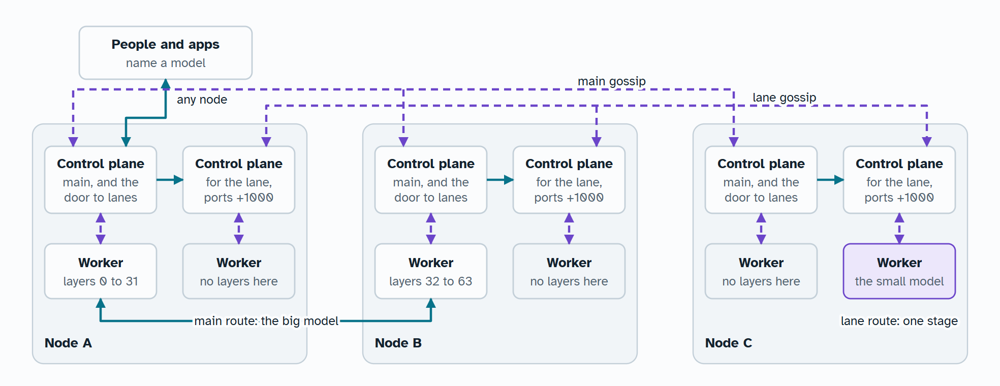
</picture>

Load another model beside the main one by giving it a lane:

```bash
isharded load Qwen3-0.6B-Q8_0.gguf --lane small --url http://node-a:8209
```

Each node then starts a control plane and a worker for that lane, on ports 1000 above its own for the first lane, 2000 for the second, and so on. A pool runs up to 7 lanes, and a lane's name is up to 32 lowercase letters, digits, and hyphens. Open those ports wherever a firewall sits between nodes. The lane gets only what each node has spare under the limits its owner set, and `--lane-gpu-gb` and `--lane-ram-gb` lower that. A node started with `--no-lanes` hosts only the main model.

A lane costs memory before any weights load. Its control plane and worker each import PyTorch, at about 0.41 GB resident and 1.13 GB committed each, measured at import. A node running the main model and 2 lanes therefore holds 6 such processes.

`GET /v1/models` lists every running model on every node, and a request goes to the model it names. The chat page shows a picker once two models run. A request that names no model goes to the main one. Keys stay with each node's main control plane, which checks the key and the rate limit before passing a request on.

Lanes are separate on purpose: a failure in one stays there, and each has its own coordinator. See or stop them with:

```bash
isharded lane list --url http://node-a:8209
```

```bash
isharded lane remove small --url http://node-a:8209
```

Removing a lane stops its processes on every node and frees their memory. Lanes come back after a restart, like the main model.

### A network nobody owns

Each node makes its own identity. Its name comes from its key, so nobody hands names out and nobody can take one:

```bash
isharded net init --dir ./identity --joining vouched --trust n-1a2b3c4d5e6f70819203
```

`--joining open` accepts anyone. `--joining vouched` accepts only nodes vouched for by nodes this one already accepts, starting from itself and whoever `--trust` names, and `--quorum` sets how many vouches it takes. Each node works this out for itself, so two nodes can disagree and neither can overrule the other.

Give your node's name to someone already in the network, and have them vouch for it:

```bash
isharded net vouch n-9f8e7d6c5b4a39281706 --dir ./identity --url http://127.0.0.1:8209
```

`isharded up --ownerless` does this for you, with the identity in `commons` in its folder, and `--join` naming a node already in the network. With `--joining vouched`, its default, it accepts only itself and the names you give with `--trust` until someone is vouched for from that folder. It has been run with `--joining open`: a founder and a second node on one machine, a model loaded and answering, and a second load refused. `--joining vouched` through `up` has not been run, so the steps here are the proven ones for that.

Start the node with `isharded node --ownerless ./identity`. Make yourself a key for your own node with `isharded key create me --role admin --file keys.json`, and pass `--keys-file keys.json`. That key is an admin of your node and means nothing anywhere else. Your users' keys live on your node too, and you set their limits.

What an operator can do on the rest of the network is propose:

| Action | Your node | The rest of the network |
|---|---|---|
| Load the first model | Yes | Yes, anyone can |
| Replace what is running | | Nobody can |
| Load a model beside it | Yes, with `--lane` | Yes, and each node hosts it only if its owner allows |
| Remove a lane | Yes, if your node proposed it | Nobody else can |
| Take a node out | Your own | Nobody can take out another's |
| Block a node | `isharded net block NAME`, for your node only | Nobody can block for anyone else |

`--host-models` lists the models your node will host, as patterns such as `*Qwen3*`, in any kind of network. A worker refuses anything else, whatever a coordinator tells it.

Nodes still pick a coordinator by lowest name, to keep a route in order. It can place work and hold a route up, but it cannot make a node host anything or change who that node accepts. Read [Current limits](#current-limits) before opening one to strangers.

With real processes, as three nodes on one machine started with `isharded node`, 27 of 27 checks passed. They covered joining by vouch, proposing and removing a model, blocking, and what the table above says nobody can do.

## Recommended configuration

### Start from your situation

| Situation | Network | Identity | Load with |
|---|---|---|---|
| You and a friend, machines anywhere | Tailscale | Shared token | Defaults |
| A few people sharing a pool | Tailscale or wired LAN | Certificates with tickets | `--parallel 4 --no-draft` |
| Closed network, no internet | Wired LAN with `--trusted-network`, or TLS | Certificates | Bare file names, `--hashes` |
| Remote machines across the internet | Tailscale, or TLS | Certificates | Defaults |
| Machines running antivirus that scans HTTPS | Tailscale | Certificates with tickets | Defaults |
| A model bigger than any one machine | Fastest link you have | Any | `--weights-ram-gb auto` on every node |

### Node settings

| Setting | Recommendation | Why |
|---|---|---|
| `--node-id` | A stable name. Give your most reliable machine the lowest | The lowest name alive coordinates |
| `--gpu-memory-gb` | Card size minus about 1.5 GB on small cards, or 20% on large ones. 4.5 on a 6 GB card, 16 on a 20 GB card | It budgets weights only. KV cache, buffers, and a GPU context of about 0.7 GiB come on top |
| `--weights-ram-gb` | `auto`, or a fixed size on a machine you also use | Lets a node hold layers beyond its VRAM |
| `--weights-disk-gb` | 0 unless a model truly cannot fit otherwise | Disk is far slower than RAM |
| `--cache-dir` | A fast SSD with room for twice the node's share | Units and stage files both live there |
| `--cache-budget-gb` | Set it on a small disk | Evicts old models past this size |
| `--ram-budget-gb` | 0 for GGUF models, a few GB otherwise | KV checkpoints speed up recovery for PyTorch models. GGUF stages keep their own saved states, and a node with this set is the first choice to hold copies of them, on its disk |
| `--log-file` | Always | Nothing is kept otherwise |
| `--location` | Set it on Tailscale, on a LAN, behind a relay, or in a cloud | The address cannot show the right country there |
| `--gguf-dir` | Point it at LM Studio's or your own model folder | Files there are read locally, not downloaded |

The entry node also carries the draft model, about 1.7 GiB of VRAM for the default one, and the planner does not reserve room for it. If you want it on a particular machine, pin that machine with `--entry`.

### Load settings

| Setting | Recommendation | Why |
|---|---|---|
| `--context-tokens` | The smallest that fits your use. 8192 is a good chat default | Each reply's context costs memory on every stage |
| `--parallel` | Your expected concurrent conversations, up to about 4 | Each one costs its own context memory |
| Draft model | Keep it. On a model with recurrent layers, keep it for one or two users and use `--no-draft` for three or more | A busy route stops guessing by itself, unless a recurrent model is checking guesses in one pass, as it does on one stage or with no native engine. See the table below |
| `--placement` | Leave at `auto` | `auto` takes the fastest, steadiest route through the fewest close workers that hold the model in VRAM. `spread` forces every worker in, however far away |
| `--hashes` | Use it when any node or mirror is less than fully trusted | Every node then checks every unit |

Measured on the test pool with Qwen3.6-27B Q4_K_M, a model with recurrent layers, total tokens per second across all conversations, at `--parallel 4`. This was before recurrent models could use a pipeline, and it has not been measured since:

| Conversations at once | No draft, merged passes | With a draft |
|---:|---:|---:|
| 1 | 14 | 10 |
| 2 | 27 | 15 |
| 3 | 32 | 20 |
| 4 | 37 | 21 |

A draft does far better at `--parallel 1`, where one conversation reached 19 to 33 tokens per second, because every stage keeps more memory and the draft's guesses are not competing.

### Network

Use wired links if you can: every token crosses every stage, so a pass costs at least one round trip per stage. Both test machines were on Wi-Fi with a 15 ms ping, and the desktop's 144 Mbps link limited model transfers to about 8 MiB/s. Fewer stages are faster, so do not add a slow machine unless the model needs its memory.

### A worked example

The test pool: a laptop with a 6 GB RTX 3060 and a desktop with a 20 GB RX 7900 XT, over Tailscale, running Qwen3.6-27B Q4_K_M. The planner gave the laptop layers 0 to 7 and the desktop layers 8 to 63.

```bash
isharded node --node-id laptop --join http://100.64.0.2:8300 --control-port 8000 --gpu-device cuda --gpu-memory-gb 4.5 --cpu-threads 4 --weights-ram-gb 6 --cache-dir D:\isharded-cache --ram-budget-gb 0.5 --gguf-dir D:\models --log-file D:\isharded-cache\node.log --ca-file ca.pem --identity-cert laptop.pem --identity-key laptop.key
```

```bash
isharded node --node-id desktop --join http://100.64.0.1:8000 --control-port 8300 --base-port 8311 --gpu-memory-gb 16 --cpu-threads 8 --weights-ram-gb auto --gguf-dir D:\models --ca-file ca.pem --identity-cert desktop.pem --identity-key desktop.key
```

```bash
isharded load lmstudio-community/Qwen3.6-27B-GGUF:Qwen3.6-27B-Q4_K_M.gguf --url http://100.64.0.2:8300 --context-tokens 8192 --parallel 2 --token YOUR_ADMIN_KEY
```

A third node and every one after it joins the same way, with `--join` naming any node already running.

## Command reference

Every `--url` takes any node's control address. Commands default to `http://127.0.0.1:8000`, which is the demo's port. A node's control port is `--base-port` plus 9, so 8209 unless you change it.

### isharded up

Starts a node with everything worked out, and is the easy way in. See [Quick start](#quick-start).

| Option | Default | What it does |
|---|---|---|
| `--invite` | None | Join a mesh, with a code from `isharded invite` |
| `--name` | This machine's name | This node's name |
| `--port` | 8209 | Port for the chat page and API |
| `--worker-port` | Nine below `--port` | This node's worker port, for clouds that hand out ports |
| `--address` | Found for you | The address other nodes reach this one on |
| `--location` | Looked up from `--address` | Two letter country code for the dashboard's flag, such as `DE`, or `none` to show no flag. Kept for next time, and a new one replaces it |
| `--tls` | Off on Tailscale | Use TLS even on Tailscale |
| `--trusted-network` | Off | Skip TLS, because nobody else can read this network |
| `--no-gpu` | Off | Contribute CPU and RAM only |
| `--gpu-gb` | A share of what is free | VRAM to give |
| `--ram-gb` | A share of what is free | RAM to give for weights |
| `--cpu-threads` | Half the cores | Threads to give |
| `--gguf-dir` | LM Studio's folders | A folder of GGUF files. Repeatable |
| `--model` | None | Load this model once the node is up, and say when it is ready or why it could not load. This needs an admin key, so it is refused on an invited machine |
| `--no-browser` | Off | Do not open the chat page |
| `--background` | Off | Leave the node running on its own, and return once it is up. Its output goes to `up.log` in its folder. If it is already up, this only opens its page, so `--model` then does nothing. The installers and shortcuts use this |
| `--find` | Off | Ask to join the one mesh on this network, without asking you first |
| `--new-mesh` | Off | Start a new mesh even if one is on this network |
| `--no-discovery` | Off | Do not look for a mesh, and do not answer machines looking for this one |
| `--ownerless` | Off | Make or join a [network nobody owns](#a-network-nobody-owns). It never adds TLS, so off Tailscale it needs `--trusted-network` |
| `--joining` | `vouched` | With `--ownerless`: who this node accepts, `open` or `vouched` |
| `--trust` | None | With `--ownerless`: a node to accept from the start. Repeatable |
| `--join` | None | With `--ownerless`: any node already in the network |

A folder runs one node. Running `isharded up` again while it is up points you at the node, and starts nothing.

### isharded stop

Stops the node `isharded up` started on this machine, in the foreground or the background, as Ctrl+C would. It waits up to a minute, then kills the node's processes. A start-at-login task stays in place, so the node comes back at the next login.

### isharded invite

Makes a code that adds a machine to this mesh, on the machine that made it. `--uses` sets how many machines it can add, 1 by default, and `--hours` how long it lasts, 24 by default.

### isharded approve and deny

`isharded approve NAME` lets in a machine that asked to join, and `isharded deny NAME` turns it down. Run them on the machine that made the mesh. The dashboard does the same.

### isharded doctor

Checks this machine and says what to fix: Python, the `cryptography` package, addresses, the port, memory, disk, local models, the native engine, and on Linux the `libgomp` library. It exits with 1 if anything needs fixing. A missing native engine does not count, because a node runs without it, but it says so and how to get it. The engine counts as present only if it loads.

### isharded service

`isharded service install` starts this node when you log in, for this user only, and `isharded service remove` stops that. It runs `isharded up --no-browser`, through a scheduled task on Windows, a systemd user unit on Linux, and a launch agent on macOS.

### isharded demo

Starts a control plane and workers on this machine, and loads a model.

| Option | Default | What it does |
|---|---|---|
| `--workers` | 2 | How many workers to start |
| `--model` | `distilbert/distilgpt2` | Model to load once they are up |
| `--device` | `auto` | `auto`, `cpu`, `cuda:0`, or another device |
| `--port` | 8000 | Control plane port. Workers use the next hundred up |
| `--pool-token` | `ISHARDED_POOL_TOKEN` | Require this token |

### isharded node

Runs one machine's share of a pool: a control plane, plus workers for what it contributes, restarted if they stop.

Joining and naming:

| Option | Default | What it does |
|---|---|---|
| `--node-id` | Computer name | This node's name. Keep it stable, because the lowest name coordinates |
| `--join` | None | Any existing nodes, comma separated. Omit on the first node |
| `--orchestrator-url` | None | Old name for `--join` |
| `--control-port` | `--base-port` + 9 | Port for this node's control plane |
| `--no-control` | Off | Worker only: run no control plane here. Needs `--join` |

Network:

| Option | Default | What it does |
|---|---|---|
| `--bind-host` | `0.0.0.0` | Address to listen on |
| `--advertise-host` | `auto` | Address other nodes reach this one on. `auto` prefers Tailscale, then the LAN |
| `--advertise-scheme` | `http` | `http` or `https`. Set to `https` for you by `--tls-cert` |
| `--location` | Looked up from `--advertise-host` | Two letter country code for the dashboard's flag, such as `DE`, or `none` to show no flag |
| `--base-port` | 8200 | First worker's port. Later workers take the next ones |

Security:

| Option | Default | What it does |
|---|---|---|
| `--pool-token-file` | `pool.token` in the iSharded folder | File holding the pool token |
| `--ca-file` | None | Authority that signed the nodes' certificates. Turns on certificate identity |
| `--identity-cert`, `--identity-key` | None | This node's certificate and key, to prove its name with tickets, without TLS |
| `--tls-cert`, `--tls-key` | None | Certificate and key for this node's servers, for TLS |
| `--keys-file` | `access.json` in the iSharded folder | Where this node keeps the pool's API keys |
| `--open` | Off | Serve a network with no credentials, trusting everyone on it |
| `--trusted-network` | Off | Send credentials unencrypted, because nobody else can read this network |

Hardware and memory:

| Option | Default | What it does |
|---|---|---|
| `--gpu-device` | `auto` | `auto` (every accelerator), `cuda:0`, `cuda:0,cuda:1`, `mps`, `xpu:0`, `vulkan`, or `none`. ROCm uses PyTorch's cuda device names. See [Any GPU](#any-gpu) |
| `--gpu-memory-gb` | 0 (auto) | VRAM budget per accelerator. A hard limit on CUDA and ROCm |
| `--dtype`, `--gpu-dtype` | `auto` | `auto` (BF16), `bfloat16`, `float32`, or `float16`, for this node's VRAM and RAM |
| `--cpu-threads` | 0 | Threads for CPU work. With no GPU, setting this adds a CPU worker |
| `--cpu-active` | Off | Place a CPU worker on normal routes, instead of keeping it on standby |
| `--weights-ram-gb` | None | System RAM for model weights, a size or `auto`. With a GPU, one worker spans both |
| `--weights-disk-gb` | 0 | Disk for memory-mapped model weights |
| `--ram-budget-gb` | 0 | RAM for KV-cache checkpoints, not weights. Adds a memory worker |
| `--state-ram-gb` | 1 | RAM each stage keeps for saved prompt states, on top of its weights. The planner does not count it |
| `--state-disk-gb` | 8 | Disk for saved prompt states, kept in `states` in `--cache-dir`. 0 keeps them in RAM only, and they then die with the stage process |
| `--state-copy-mb` | 10 | MB per second for sending copies of saved states to another node. 0 sends none |

Models and cache:

| Option | Default | What it does |
|---|---|---|
| `--gguf-dir` | None | Folder to search for GGUF files already here, such as LM Studio's. Repeatable |
| `--model-dir` | None | A folder of local models peers may ask this node to load. Repeatable |
| `--llama-dir` | Downloaded | A llama.cpp build for GGUF models. Needed on closed networks |
| `--cache-dir` | `~/.cache/isharded/units` | Where fetched weights are kept. Put it on a fast disk |
| `--cache-budget-gb` | 0 (no limit) | Evict old models past this size |
| `--no-peer-fetch` | Off | Always download from the model host |
| `--no-peer-serve` | Off | Do not send shards to other workers |

Other:

| Option | Default | What it does |
|---|---|---|
| `--log-file` | None | Write this node's output here. Over 64 MiB, the last one is kept as `.1` at the next start |
| `--no-local-copy` | Off | Run workers from a network path as it is, instead of copying the code to local disk |
| `--no-lanes` | Off | Host only the main model here, never one loaded with `load --lane` |
| `--host-models` | Any | Comma-separated patterns such as `*Qwen3*`. Host only models that match |
| `--ownerless` | Off | Join a network nobody owns, using the identity folder from `isharded net init` |

A node contributes whatever you give it. With a GPU and weight memory, one worker spans them all. With no GPU, `--cpu-threads` or a weight budget adds a CPU worker. `--ram-budget-gb` adds a memory worker on the next port. A node that contributes nothing is refused.

### isharded load

Loads a model on a running pool and shows progress. `model` is any [model id](#loading-a-model).

| Option | Default | What it does |
|---|---|---|
| `--url` | `http://127.0.0.1:8000` | Any node's control address |
| `--token`, `--pool-token` | This machine's pool token | An admin key |
| `--context-tokens` | 4096 | Tokens each reply can hold |
| `--parallel` | 1 | Replies to run at once. Each costs its own context memory |
| `--placement` | `auto` | `auto` picks the fastest route, `spread` uses every worker, `compact` the fewest that fit |
| `--entry`, `--exit` | Chosen for speed | Worker to hold the entry or exit stage |
| `--draft` | Chosen automatically | Small GGUF for speculative decoding |
| `--no-draft` | Off | Turn speculative decoding off |
| `--no-merge-passes` | Off | Make conversations take turns on each stage |
| `--no-prompt-cache` | Off | Read every prompt in full instead of reusing saved states. See [Conversation reuse](#conversation-reuse) |
| `--kv-type` | `f16` | How a GGUF model keeps attention KV. `q8_0` takes about half the memory. See [Conversation reuse](#conversation-reuse) |
| `--hashes` | None | File from `isharded model hash`. Every node checks every unit against it |
| `--no-reuse-cached` | Off | Plan as if no worker held any shards |
| `--no-peer-fetch` | Off | Download every shard from the model host |
| `--lane` | None | Load beside the running model, in a lane of this name. See [Several models at once](#several-models-at-once) |
| `--lane-gpu-gb` | What is spare | Most VRAM per node for this lane |
| `--lane-ram-gb` | What is spare | Most RAM per node for this lane |
| `--lane-apart` | Off | Keep this lane off every node another route uses, so routes can check each other |
| `--embedding` | Off | This is an embedding model: one stage, for `/v1/embeddings` and not chat. See [Embeddings](#embeddings) |
| `--mmproj` | None | Projector GGUF for images, hosted on the entry stage and found by name like other GGUF files. See [Vision](#vision) |

### isharded lane

`isharded lane list` shows the pool's lanes, and `isharded lane remove NAME` stops one and frees its memory on every node. Both take `--url` and `--token` (`--pool-token`), as `load` does.

### isharded net

For a [network nobody owns](#a-network-nobody-owns).

| Command | What it does |
|---|---|
| `isharded net init --dir DIR` | Make this node's identity. `--joining` is `open`, the default here, or `vouched`. `--quorum` is the vouches a node needs, 1 by default, and `--trust NAME` accepts a node from the start |
| `isharded net vouch NAME --dir DIR --url URL` | Say this node accepts another |
| `isharded net show --url URL --token KEY` | This node's own view: who it accepts, blocks, and can see |
| `isharded net block NAME --url URL --token KEY` | Stop this node dealing with another. Only this node is affected |
| `isharded net unblock NAME --url URL --token KEY` | Undo that |

### isharded audit

Asks every route serving a model the same questions, and compares the answers. See [Checking answers](#checking-answers).

| Option | Default | What it does |
|---|---|---|
| `--model` | The main model | The model to check |
| `--samples` | 8 | Questions to ask each route, up to 64 |
| `--every` | Off | Keep checking, this many seconds apart |
| `--url`, `--token` (`--pool-token`) | | As for `load` |

It exits with 1 if routes disagree, so it can sit in a script. With `--every` it keeps going through a disagreement, and stops only if a check is refused.

### isharded bench

Measures a running mesh and gives numbers others can compare. It asks a node over the normal API, the way any client does, and changes nothing.

```bash
isharded bench
isharded bench --url http://node-a:8209 --key YOUR_KEY --markdown result.md
isharded bench --prompt-tokens 128 --parallel 1,2 --repeat 5 --text code --json result.json
```

| Option | Default | What it does |
|---|---|---|
| `--prompt-tokens` | 128,3400 | Prompt sizes to try, as a comma list |
| `--tokens` | 200 | How many tokens each reply runs to |
| `--parallel` | 1,4,8 | Replies at once to try, as a comma list. One at a time always runs, as the numbers for a single reply come from it |
| `--repeat` | 3 | How many times to measure each case |
| `--warmup` | 1 | Replies to throw away before each prompt size |
| `--seed` | 1 | Seed for the prompts and the replies |
| `--temperature` | 0 | Sampling temperature |
| `--text` | prose | What the prompts are made of: `prose`, `code` or `counting` |
| `--cached` | Off | Also send each prompt a second time, and time its first token from the cache |
| `--json` | Off | Also write the results to this file as JSON |
| `--markdown` | Off | Also write the results to this file as Markdown, ready to paste |
| `--url` | This machine's node | Any node's address |
| `--key` | This machine's own | An API key. A user key is enough. See below |

With no `--url` it reads the `up` folder, so `isharded bench` on a node just works. The saved key, or the pool token, goes only to this machine's own node. For any other `--url`, give `--key`, so that benching someone else's mesh cannot hand them your key. In the same way this mesh's certificate authority is used only for this machine's own node. For a node elsewhere whose certificate comes from a mesh's own authority, name that authority's file in `ISHARDED_CA_FILE`.

Each prompt size starts with a few one-token requests that find how much text comes to that size on the model's own tokenizer, because a node has no route for counting. Prompts are fixed text in the module behind a prefix that is new every time, so nothing comes from the prompt cache, not even from an earlier run with the same seed. The table shows the size the prompts came to, which usually lands within 16 tokens or 2% of the size asked for. A size the model was not loaded with room for is skipped and noted. The defaults need a load with `--context-tokens` of 4096 or more.

What it reports:

| Number | What it means |
|---|---|
| First token ms | From sending the request to the first text arriving, measured on the client. With several replies at once this includes waiting behind the others |
| Cached first token ms | The same, for a prompt the node has just seen. Only with `--cached` |
| Tokens/s per reply | Tokens after the first, divided by the time between the first and the last. Token counts come from the node's usage line |
| Total tokens/s | All the tokens of a round, divided by the whole round, reading prompts included. This is what the mesh delivers |
| Repeat of a seeded reply identical | The same seeded request, sent twice. `NO` deserves a look, as one route should repeat itself. It does not fail the run |

Each number is the median of the measurements, with the lowest and highest in brackets. The report also says what explains them: the model and its quantization (read from the name), each stage's layers, GPU and country, link times where the status has them, the pipeline's tokens, misses and depth, any draft's passes in this run and its tokens per pass since the stage started, whether the native engine was on, the iSharded version nodes report, and the commit of the copy running the bench, if it is a git checkout. It leaves out addresses, keys, machine names and paths, so it is safe to post. Countries appear only where a node's operator shows one.

Notes under the table say when something bent the numbers: a route that moved, cache use nobody asked for, `--cached` with no cache behind it, replies that ended before `--tokens`, sizes skipped. A node keeps prompt states only with room for them, in `--state-ram-gb` or `--state-disk-gb`. It exits with 1 if any reply failed, or if nothing could be measured. A repeat that differs does not fail it, and neither does a size the model has no room for.

Read the numbers fairly. Two results compare only with the same model, the same quantization, and the same prompt size and reply length. After that:

- Compare `--text` with `--text`. `counting` is the easy case for a draft and a pipeline, and `code` is easier than `prose`. A result from `counting` says nothing about chat.
- Say what the route was. Two stages in one room and seven over the internet are different things, and the report shows which you measured.
- Tokens/s per reply and total tokens/s answer different questions. One person waiting feels the first. A shared mesh is judged by the second.
- Above the `--parallel` a model was loaded with, replies wait in line, so first token times grow and total tokens/s stops growing. That is the load's choice and not the mesh's limit.
- Other traffic on the mesh lands in the numbers. Look at the spread in the brackets: a wide one means the run was disturbed, or `--repeat` was too low to say.
- A rate limit on the key fails replies. Use a key without one.

### isharded cordon and uncordon

`cordon` moves a node's share elsewhere for maintenance, and `uncordon` puts the node back. Both take the node's name.

| Option | Default | What it does |
|---|---|---|
| `--url` | `http://127.0.0.1:8000` | Any node's control address |
| `--token` | This machine's pool token | An admin key |
| `--force` | Off | `cordon` only: go ahead even if this moves over 2 GiB between nodes |

### isharded model hash

Hashes a model on a copy you trust, for `load --hashes`. It reads the whole model. `source` is a GGUF file or a safetensors folder.

| Option | Default | What it does |
|---|---|---|
| `--out` | Required | The file to write |

### isharded key

`key create NAME` makes an API key and shows it once. It needs `--file`, or `--dir` and `--url`. On a mesh from `isharded up`, run it on the owner's machine with `--dir` set to the folder `isharded up` uses and `--url` set to `https://127.0.0.1:8209`, or `http` on Tailscale. `key remove NAME` removes one for good, and needs the authority. An admin key made before this version acts only as `user` when another node passes its requests on, so [make a new one](SECURITY.md#keys-made-before-verifiers) if you use it through more than one node.

| Option | Applies to | Default | What it does |
|---|---|---|---|
| `--role` | create | `user` | `user` or `admin` |
| `--requests-per-minute` | create | 0 (no limit) | Rate limit for this key |
| `--file` | create | None | Add it to a key file, for nodes to read with `--keys-file` |
| `--dir` | both | None | The pool's secrets folder. Sign the change with its authority and send it to `--url` |
| `--url` | both | `http://127.0.0.1:8000` | Any node's control address, with `--dir` |

### isharded pool

Commands for a pool's credentials and members.

| Command | What it does |
|---|---|
| `pool init --dir DIR` | Makes a pool token and authority in a new folder. Keep this folder off the nodes |
| `pool add-node NAME --dir DIR --address ADDRESS` | Issues a node its certificate and key directly |
| `pool request-join NAME --dir DIR --address ADDRESS --url URL` | Asks to join. The node's key stays in `--dir`. Add `--wait` to wait for the answer |
| `pool requests --token KEY --url URL` | Shows who is asking to join |
| `pool approve NAME --dir DIR --token KEY --url URL` | Lets a node in |
| `pool deny NAME --dir DIR --token KEY --url URL` | Turns a node down. That key stays denied |
| `pool revoke NAME --dir DIR --url URL` | Throws a node out for good. Bring a machine back under a new name |

`--address` is an address peers use for that node, and is repeatable. `--token` is an admin key.

### isharded mcp

`isharded mcp` serves a mesh to an MCP client over stdio. `isharded mcp run PROMPT` gives a model on the mesh the tools of MCP servers, and prints its answer. [MCP](#mcp) has the details.

| Option | Applies to | Default | What it does |
|---|---|---|---|
| `--url` | both | `http://127.0.0.1:8000` | Any node's control address |
| `--token` | both | This machine's pool token | A user key |
| `--model` | run | Required | The model to use. It must support [tool calling](#tool-calling) |
| `--server` | run | Required | The command that starts an MCP stdio server, or the `http://` or `https://` URL of a Streamable HTTP one. Repeatable |
| `--allow` | run | None | A tool that may run without asking. Repeatable |
| `--pass-env` | run | None | An environment variable servers may see, beyond the basics. Repeatable |
| `--max-turns` | run | 8 | Most times the model may be asked before giving up |
| `--max-tokens` | run | The API's default | Longest reply on each turn |
| `--tool-timeout` | run | 60 | Seconds a tool may take |

### isharded assistant

Runs [the assistant](#the-assistant). [Its guide](ASSISTANT.md) covers its commands and options.

### Running the pieces by hand

`isharded node` starts these for you. Start them directly only for unusual layouts, such as a control plane on a machine with no workers.

`python -m isharded.orchestrator` runs a control plane:

| Option | Default | What it does |
|---|---|---|
| `--host` | `0.0.0.0` | Address to listen on |
| `--port` | 8000 | Port to listen on |
| `--node-id` | None | This node's name in the mesh |
| `--advertise-url` | None | How other nodes reach this one. Setting it joins the mesh |
| `--join` | None | Any existing nodes, comma separated |
| `--state-file` | `orchestrator-state.json` in the state folder | Where the running route is saved |
| `--keys-file` | `access.json` in the iSharded folder | Where this node keeps the pool's API keys |
| `--audit-file` | `audit.jsonl` in the state folder | Where to record who did what |
| `--lane` | None | Run as this lane, beside a node's main control plane. `isharded node` sets this for you |
| `--no-reuse-cached` | Off | Plan as if no worker held any shards |
| `--no-peer-fetch` | Off | Always download from the model host |
| `--open` | Off | Serve a network with no credentials |
| `--trusted-network` | Off | Send credentials unencrypted, on a network nobody else can read |

The state folder is `%LOCALAPPDATA%\iSharded` on Windows and `~/.cache/iSharded` elsewhere. The iSharded folder is `%LOCALAPPDATA%\iSharded` on Windows and `~/.isharded` elsewhere.

`python -m isharded.worker` runs one worker:

| Option | Default | What it does |
|---|---|---|
| `--host` | `0.0.0.0` | Address to listen on |
| `--port` | 8100 | Port to listen on |
| `--worker-id` | Computer name | Unique name. Use `node-gpu`, `node-cpu`, or `node-memory` so certificates match |
| `--orchestrator-url` | `http://127.0.0.1:8000` | One or more control planes, comma separated. The rest are found from them |
| `--advertise-url` | `http://127.0.0.1:PORT` | How other nodes reach this worker |
| `--location` | Looked up from `--advertise-url` | Two letter country code to report |
| `--device` | `auto` | `auto`, `cpu`, `cuda:0`, `mps`, or `xpu:0` |
| `--roles` | `inference` | `inference`, or `kv-cache,checkpoint` for a memory worker |
| `--dtype` | `auto` | `auto` is BF16. `float32` runs this worker at full precision |
| `--cpu-threads` | 0 | CPU threads. 0 uses half the cores for a stage |
| `--gpu-memory-gb` | 0 (auto) | VRAM budget per accelerator |
| `--weights-ram-gb` | None | System RAM for model weights, or `auto` |
| `--weights-disk-gb` | 0 | Disk for memory-mapped model weights |
| `--ram-budget-gb` | 0 | RAM for KV checkpoints, not weights |
| `--state-ram-gb`, `--state-disk-gb` | 1, 8 | RAM and disk for saved prompt states |
| `--state-copy-mb` | 10 | MB per second for copies of saved states to another node |
| `--cache-dir` | `~/.cache/isharded/units` | Where fetched weights live |
| `--cache-budget-gb` | 0 (no limit) | Evict old models past this size |
| `--gguf-dir` | None | Folder holding GGUF files. Repeatable |
| `--llama-dir` | Downloaded | A llama.cpp build for GGUF models |
| `--no-peer-fetch` | Off | Always download from the model host |
| `--no-peer-serve` | Off | Do not send shards to other workers |
| `--standby` | Off | Only use this worker when a model does not fit without it |
| `--host-models` | Any | Comma-separated patterns. Host only models that match |
| `--open` | Off | Serve a network with no credentials |
| `--trusted-network` | Off | Send credentials unencrypted, on a network nobody else can read |

## Environment variables

A flag takes priority over its variable.

| Variable | Same as, or what it does |
|---|---|
| `ISHARDED_POOL_TOKEN` | The pool token, ahead of any token file |
| `ISHARDED_POOL_TOKEN_FILE` | `--pool-token-file` |
| `ISHARDED_CA_FILE` | `--ca-file` |
| `ISHARDED_IDENTITY_CERT`, `ISHARDED_IDENTITY_KEY` | `--identity-cert`, `--identity-key` |
| `ISHARDED_TLS_CERT`, `ISHARDED_TLS_KEY` | `--tls-cert`, `--tls-key` |
| `ISHARDED_KEYS_FILE` | `--keys-file` |
| `ISHARDED_STATE_FILE` | `--state-file` |
| `ISHARDED_AUDIT_FILE` | `--audit-file` |
| `ISHARDED_HOST`, `ISHARDED_PORT` | `--host`, `--port` |
| `ISHARDED_OWN_ADDRESS` | Set by a node for its own services, so a request for its public address goes over loopback. Many networks will not loop a machine's public address back to it. Behind a relay that other nodes share, set it to a list of `host:port` |
| `ISHARDED_NODE_ID`, `ISHARDED_NODE_URL`, `ISHARDED_JOIN` | The control plane's `--node-id`, `--advertise-url`, `--join` |
| `ISHARDED_WORKER_ID`, `ISHARDED_ORCHESTRATOR_URL`, `ISHARDED_ADVERTISE_URL`, `ISHARDED_LOCATION` | The worker's `--worker-id`, `--orchestrator-url`, `--advertise-url`, `--location` |
| `ISHARDED_DEVICE`, `ISHARDED_ROLES`, `ISHARDED_CPU_THREADS` | `--device`, `--roles`, `--cpu-threads` |
| `ISHARDED_GPU_MEMORY_GB`, `ISHARDED_RAM_BUDGET_GB` | `--gpu-memory-gb`, `--ram-budget-gb` |
| `ISHARDED_STATE_RAM_GB`, `ISHARDED_STATE_DISK_GB`, `ISHARDED_STATE_COPY_MB` | `--state-ram-gb`, `--state-disk-gb`, `--state-copy-mb` |
| `ISHARDED_CACHE_DIR`, `ISHARDED_LLAMA_DIR` | `--cache-dir`, `--llama-dir` |
| `ISHARDED_LANE`, `ISHARDED_LANES_FILE` | Set by `isharded node`: which lane a process is, and where a node keeps the lanes it should run |
| `ISHARDED_OWNERLESS` | `--ownerless` |
| `ISHARDED_UP_HOME` | Where `isharded up` keeps its settings and keys |
| `ISHARDED_DISCOVERABLE` | Set by `isharded up`: answer machines looking for a mesh |
| `ISHARDED_HOST_MODELS` | `--host-models` |
| `ISHARDED_MODEL_DIRS` | `--model-dir`, separated by the system's path separator |
| `ISHARDED_REUSE_CACHED`, `ISHARDED_PEER_FETCH` | Set to `0` for the control plane's `--no-reuse-cached`, `--no-peer-fetch` |
| `ISHARDED_ENGINE` | Set to `0` to run without the native engine, on the Python path |
| `ISHARDED_ENGINE_LIB` | The native engine's library, if it is not in `isharded/native` |
| `ISHARDED_DRAFT_APART` | Set to `1` on the entry worker to run the draft in a process of its own, not beside the entry stage. Use it to compare the two on a real mesh |
| `ISHARDED_RING` | Set to `0` on the coordinator to keep replies off the direct links between stages |
| `ISHARDED_PROMPT_PARTS` | Set to `0` on the entry worker to send each prompt whole instead of in parts |
| `ISHARDED_DATA_PORT` | The port for direct links between stages. It must be reachable from the other stages. Default: any free port |
| `ISHARDED_HOST_ID` | Which physical machine a worker is on. Defaults to the computer name, so workers sharing a host do not count its RAM twice |
| `ISHARDED_FETCH_CONCURRENCY` | Units a worker fetches at once. Default 4 |
| `ISHARDED_ACCESS_LOG` | Set to `1` to log every request while debugging. Off by default, because nodes poll each other constantly |
| `ISHARDED_MAX_CONNECTIONS` | Connections one process holds before it answers 503. Default 2048. Raise it for a pool of many nodes |
| `ISHARDED_INSTALL_DIR`, `ISHARDED_SOURCE`, `ISHARDED_RELEASE_URL`, `ISHARDED_UV_URL` | For the install scripts only. See [Install](#install) |
| `ISHARDED_INSTALL_TEST` | For the tests only: `1` loads an install script's functions without installing |
| `HF_TOKEN`, `HUGGING_FACE_HUB_TOKEN` | Hugging Face token, for gated models. Needed on each worker |
| `HF_ENDPOINT` | Another Hugging Face address, such as a mirror |

A worker's launcher also passes some flags through `ISHARDED_WEIGHTS_RAM_GB`, `ISHARDED_WEIGHTS_DISK_GB`, `ISHARDED_CACHE_BUDGET_GB`, `ISHARDED_PEER_SERVE`, `ISHARDED_GGUF_DIRS`, `ISHARDED_DTYPE`, and `ISHARDED_STANDBY`. Use the flags for those, because they overwrite the variables. `ISHARDED_STAGE_KEY` is internal. The assistant's settings are in [its guide](ASSISTANT.md).

## HTTP API

Send `Authorization: Bearer KEY`, except where it says none. Requests are limited to 16 MiB, or 16 KiB on routes that take a body with no credentials, which are also limited per address and answer 429 with `Retry-After`. Each node serves all of this, and passes `/admin` requests to the coordinator for you. In a pool with an authority your key stays on the node you gave it to, and that node [signs a statement](SECURITY.md#when-one-node-passes-a-request-to-another) saying you asked. There is no `/docs` or `/openapi.json`, so this table is the reference.

### Endpoints

| Method | Path | Needs | Purpose |
|---|---|---|---|
| `POST` | `/v1/chat/completions` | User key | Chat, streaming with `stream: true`, and [tool calling](#tool-calling) |
| `POST` | `/v1/completions` | User key | Text completion, one prompt per request |
| `POST` | `/v1/embeddings` | User key | Vectors for text, from an embedding model. See [Embeddings](#embeddings) |
| `GET` | `/v1/models` | User key | Every running model, and what each is for, with the fields OpenAI and Claude clients read. Takes the key as `x-api-key` too |
| `GET` | `/v1/models/{model_id:path}` | User key | The same row for one model, or a 404. Takes the key as `x-api-key` too |
| `POST` | `/v1/messages` | User key | [Claude Messages](#claude-messages), streaming with `stream: true`. Takes the key as `x-api-key` too |
| `POST` | `/v1/messages/count_tokens` | User key | How many tokens a Messages request comes to. Takes the key as `x-api-key` too |
| `POST` | `/v1/responses` | User key | [OpenAI Responses](#openai-responses), streaming with `stream: true` |
| `POST` | `/api/chat` | User key | [Ollama](#ollama) chat. Streams unless `stream` is `false` |
| `POST` | `/api/generate` | User key | Ollama text generation. Streams unless `stream` is `false` |
| `POST` | `/api/embed` | User key | Ollama vectors for one text or a list |
| `POST` | `/api/embeddings` | User key | Ollama's older vector route, for one `prompt` |
| `GET` | `/api/tags` | User key | Every running model, in Ollama's shape |
| `POST` | `/api/show` | User key | What Ollama clients ask about one running model |
| `GET` | `/api/ps` | User key | Running models, in Ollama's shape |
| `GET` | `/api/version` | User key | An Ollama version clients accept, and iSharded's own in `isharded` |
| `POST` | `/api/pull`, `/api/push`, `/api/create`, `/api/copy`, `/api/blobs/{digest}` | User key | Refused with a 400 that says to load models through iSharded |
| `DELETE` | `/api/delete` | User key | The same |
| `POST` | `/mcp` | User key | [MCP](#mcp) over Streamable HTTP. `GET` and `DELETE` answer 405, since there is no stream or session |
| `GET` | `/admin/status` | User key | Workers and their `country`, memory pools, route, measured [`links`](#what-a-route-costs), epoch, mesh, lanes, load progress, and the last answer check |
| `GET` | `/admin/catalog` | User key | Suggested models and supported architectures |
| `POST` | `/admin/plan` | Admin key | Show where a model would run, without moving anything |
| `POST` | `/admin/load` | Admin key | Load a model |
| `POST` | `/admin/load/cancel` | Admin key | Stop a load. Finished units stay cached |
| `DELETE` | `/admin/lanes/{name}` | Admin key | Stop a lane and free its memory on every node |
| `POST` | `/admin/join/{name}/{answer}` | Admin key | Answer a machine asking to join, with `approve` or `deny`, on the machine that made the mesh |
| `POST` | `/admin/audit` | Admin key | Ask routes serving `model` the same `samples` questions, up to 64, and compare. Each node runs this itself |
| `POST` | `/admin/invites` | Admin key | Make a code that adds a machine. Takes `uses` and `hours`, and only the machine that made the mesh can |
| `GET` | `/join/authority` | None | The mesh's public certificate, for a new machine to check against its invite |
| `GET` | `/admin/network` | User key | In a network nobody owns, this node's own view. `/admin/status` shows the coordinator's |
| `GET` | `/admin/inventory` | User key | Each node's system, disks, GPU temperature and power, load, battery, and round trip from this node, where the machine reports them |
| `DELETE` | `/admin/nodes/{name}/revoke` | Admin key | In a network nobody owns, undo this node's block on another |
| `POST` | `/admin/rebalance` | Admin key | Reconsider all live workers and apply a new layout |
| `POST` | `/admin/nodes/{name}/cordon` | Admin key | Move a node's share elsewhere. `?force=true` allows a large transfer |
| `POST` | `/admin/nodes/{name}/uncordon` | Admin key | Put a node back in service |
| `POST` | `/admin/nodes/{name}/revoke` | Admin key | Throw a node out, in a pool without an authority. In a network nobody owns, block it for this node only |
| `GET`, `POST` | `/admin/keys` | Admin key | List or create keys, in a pool without an authority |
| `DELETE` | `/admin/keys/{name}` | Admin key | Remove a key, in a pool without an authority |
| `POST` | `/access/entries` | A valid signature | Apply a change signed by the pool authority |
| `POST` | `/join/requests` | None | Ask to join. Grants nothing |
| `GET` | `/join/requests` | Admin key | List who is waiting |
| `GET` | `/join/certificate/{name}` | None | Collect an approved node's certificate |
| `GET` | `/ready` | None | 200 when this node can serve a reply, for load balancers |
| `GET` | `/health` | None | The process is up. Says nothing else to strangers |
| `GET` | `/metrics` | Admin key | Prometheus metrics |
| `GET` | `/chat`, `/dashboard` | None | The pages. They ask for a key themselves |

Routes under `/internal` are for nodes only. `GET /internal/mesh` shows a node's own view of the mesh, and `GET /internal/diag/tasks` shows where everything in a process is waiting, which is the place to look when a reply stalls.

### Chat and completion requests

| Field | Default | What it does |
|---|---|---|
| `messages` | Required for chat | List of `role` and `content`. `content` is a string, or a list of `text` and `image_url` parts. See [Vision](#vision). An assistant message may carry `tool_calls` and no content, and a `tool` message answers one with `tool_call_id`. `name` is optional |
| `prompt` | Required for completions | A string, or a list holding one string |
| `model` | The main model | Any running model, in a lane or not. A name that is not running gets a 404 |
| `max_tokens` | 32, or 4096 with tools in play | 1 to 32768 |
| `max_completion_tokens` | None | Chat only: the same limit under OpenAI's newer name, and it wins if both are sent |
| `temperature` | 0 | 0 to 5. 0 picks the most likely token |
| `top_p` | 1 | Above 0, up to 1 |
| `top_k` | 0 | 0 is off |
| `seed` | None | For repeatable sampling, below 2^63 |
| `stream` | `false` | Send tokens as server-sent events, ending with `data: [DONE]` |
| `stop` | None | A string or list that ends the reply |
| `enable_thinking` | None | Chat only: switches reasoning on models that support it |
| `tools` | None | Chat only: functions the model may call. See [tool calling](#tool-calling) |
| `tool_choice` | `auto` | Chat only: `auto`, `none`, `required`, or a named function |
| `parallel_tool_calls` | `true` | Chat only: `false` keeps only the first call in a reply |

Prompts longer than the loaded context are refused with a 400. A reply that would overrun it is cut short.

### Tool calling

`/v1/chat/completions` takes OpenAI's tool fields and answers in OpenAI's shape, so existing clients work unchanged. A reply with calls has `tool_calls` with ids, and `finish_reason: "tool_calls"`. Send the result back as a `tool` message with the call's `tool_call_id`.

```python
from openai import OpenAI

client = OpenAI(base_url="http://NODE:8209/v1", api_key="KEY")
tools = [{"type": "function", "function": {"name": "get_weather", "parameters": {
    "type": "object", "properties": {"city": {"type": "string"}}, "required": ["city"]}}}]
messages = [{"role": "user", "content": "What is the weather in Paris?"}]

message = client.chat.completions.create(model=MODEL, messages=messages, tools=tools).choices[0].message
messages.append(message)
for call in message.tool_calls or []:
    messages.append({"role": "tool", "tool_call_id": call.id, "content": '{"temperature_c": 17}'})
print(client.chat.completions.create(model=MODEL, messages=messages, tools=tools).choices[0].message.content)
```

Tools go through the model's own chat template, which is how it was trained to see them. The template also decides how replies are read, so a fine-tune of a family needs nothing configured. A template with no format listed here is refused with a 400, because tools pasted into a prompt the model was not trained on would only look as if they worked.

| Family | How it writes a call | Status here |
|---|---|---|
| Qwen3 | `<tool_call>` around JSON | Run on a real model, see below |
| Qwen3.5 | `<function=name><parameter=key>` in XML | Run on a real model, see below |
| Qwen2.5 | `<tool_call>` around JSON | Not run on a model. Its real template renders a tool conversation, and its calls read back |
| Qwen3-Coder | `<function=name><parameter=key>` in XML | The same |
| Hermes 2 and 3 | `<tool_call>` around JSON, through their `tool_use` template | The same, and they cannot load here yet: they are built on Llama |
| Llama 3.1, 3.2 | `{"name": ..., "parameters": ...}`, sometimes after `<\|python_tag\|>` | The same, and they cannot load here yet. Their templates take one call per message, so a conversation holding parallel calls is refused |
| Mistral 7B v0.3 | `[TOOL_CALLS]` and a JSON list | The same, and it cannot load here yet |
| Mistral Small 3.2 | `[TOOL_CALLS]name[ARGS]{...}` | The same, and it cannot load here yet |
| GLM-4.5, 4.6, 4.7 | `<tool_call>name<arg_key>key</arg_key><arg_value>value</arg_value></tool_call>` | The same, and they cannot load here yet |

"Cannot load here yet" means the parser is ready and the mesh is not: GGUF tokenizers cover `qwen2` and `qwen35` vocabularies only, and neither family is on the PyTorch path. See [Supported families](#supported-families). Other families, such as DeepSeek, are refused rather than guessed at.

What comes back:

- A call counts when it names a function that was offered and its arguments are a JSON object. Anything else comes back in `content` exactly as the model wrote it, because a client can use that, and a call made up from it could do harm.
- A call cut off by the token limit comes back as text, with `finish_reason: "length"`. The default limit is 4096 with tools in play, since clients following OpenAI send none, and the usual 32 would cut a call in half.
- Reasoning stays in `content` inside `<think>`, as in any reply, and is never read as a call. Templates take it out again when the message is sent back.
- XML writes every value as text, so values are converted using the tool's schema. One that does not fit stays as written, for your own checks to catch.
- A stream holds back text that might be a call until it is one or clearly is not, so markup never reaches a client as content. A call is sent once it has been read whole, as one delta with the id and name and one with the arguments, so arguments do not arrive token by token.
- Replies with tools work through lanes, followers, and failover like any others.
- One request can carry tools and [images](#vision) together, on a model that can see. This has run on a real model with one request: a tool, an image, and `tool_choice: "required"`, on Qwen3.5-0.8B with its projector, which gave a call.

`tool_choice` sets what the model must do:

| Value | What happens |
|---|---|
| `auto` | The model decides |
| `none` | Tools stay out of the prompt, and nothing is read as a call |
| `required` | The prompt ends with the start of a call, so the model has begun one before it writes a word |
| `{"type": "function", "function": {"name": "f"}}` | The same, with the function already named, and only one call is kept |

A forced call skips reasoning whatever `enable_thinking` says, and works on any route with no change to the workers. It is only half a constraint: the start is forced, and the arguments are still the model's own, so check them against your schema. There is no grammar here. If the model still writes no usable call, the reply says so plainly in `content` with `finish_reason: "stop"`, and no call is made up.

Small models were measured on a real node, on CPU with four threads, through the official `openai` client with five tools offered. Each of 24 prompts ran whole and streamed. A full loop means the right tool, the right arguments, and then a final answer that uses the result. Default settings are what a client gets by sending nothing, which is temperature 0. Sampled means temperature 0.6, `top_p` 0.95, and `top_k` 20.

| Model | Format | Settings | Right tool | Right arguments | Full loop | Time per loop |
|---|---|---|---:|---:|---:|---:|
| Qwen3-0.6B Q8_0 | JSON | Default | 47 of 47 | 47 of 47 | 39 of 47 | 14 s |
| Qwen3-0.6B Q8_0 | JSON | Sampled | 48 of 48 | 47 of 48 | 43 of 48 | 16 s |
| Qwen3.5-0.8B Q8_0 | XML | Default | 48 of 48 | 48 of 48 | 46 of 48 | 3 s |
| Qwen3.5-0.8B Q8_0 | XML | Sampled | 48 of 48 | 48 of 48 | 45 of 48 | 4 s |
| Qwen3.6-27B Q4_K_M, across two machines | XML | Default, no thinking | 48 of 48 | 48 of 48 | 44 of 48 | 5 s |

| Model | Full loops with `required` | Full loops with a named function |
|---|---:|---:|
| Qwen3-0.6B Q8_0 | 48 of 48 | 48 of 48 |
| Qwen3.5-0.8B Q8_0 | 45 of 48 | 45 of 48 |

- The 27B ran on the two-machine pool, split over a laptop and a desktop. All four of its misses were the test's own: it answered `10,000` and `9,401`, right but with a comma the check did not allow. With `required` and with a named function it did the same on the one prompt that hit this, and passed the rest of 8 each. It called no tool on 8 prompts that needed none.
- Neither small model called a tool on any of its 16 prompts that needed none.
- Forced calls named the right tool in all 192 runs. Full loops count both settings.
- Nearly every failure came after a correct call. The model answered without using the result, called again, or, with Qwen3, never finished reasoning and gave no answer at all.
- At default settings, whole and streamed replies were identical on every prompt.
- One Qwen3 run is left out of the table, because other tests were starving the node of CPU and it failed for that reason.
- Qwen3 is slower because it reasons first. Forced calls skip that, and took it about 6 s.
- These prompts are easy: one step and one call, and several name the tool. They say little about longer tasks, and larger models were not measured.
- Neither model wrote two different calls in one reply, so true parallel calls have only run with scripted replies.

On two nodes on one machine, the same loop ran through the coordinator, a follower, and a lane, whole and streamed. A worker was then killed while the model was still reasoning, first the one holding most of the layers, then the entry worker. Both times the route repaired itself and the client still got the call.

### Load requests

`POST /admin/load` and `/admin/plan` take these fields. `isharded load` sets most of them for you.

| Field | Default | What it does |
|---|---|---|
| `model_id` | `distilbert/distilgpt2` | Any [model id](#loading-a-model) |
| `lane` | None | Load beside the main model, in a lane of this name |
| `lane_gpu_gb`, `lane_ram_gb` | What is spare | Most VRAM and RAM per node for a new lane |
| `lane_apart` | `false` | Keep a new lane off every node another route uses |
| `revision` | `main` | Branch, tag, or commit on the model host |
| `control_model_id` | None | Read the description from here instead of `model_id` |
| `worker_model_ids` | None | A local source per worker, as worker name to path |
| `placement` | `auto` | `auto`, `spread`, or `compact` |
| `context_tokens` | 4096 | 128 to 1048576 |
| `parallel` | 1 | 1 to 32 |
| `entry_worker`, `exit_worker` | None | Pin the ends of the route |
| `draft_model` | `auto` | A GGUF id, `auto`, or `none` |
| `draft_tokens` | 6 | Most guesses out at once, 1 to 16 |
| `merge_passes` | `true` | Let conversations share a pass |
| `prompt_cache` | `true` | Reuse saved prompt states |
| `kv_type` | `f16` | How a GGUF model keeps attention KV: `f16` or `q8_0` |
| `model_hashes` | None | The contents of an `isharded model hash` file |
| `embedding` | `false` | This is an embedding model. See [Embeddings](#embeddings) |
| `mmproj` | None | A projector GGUF for images. See [Vision](#vision) |
| `reuse_cached`, `peer_fetch` | Pool default | Weigh cached shards, and copy from peers |
| `wait` | `true` | `false` returns at once. Progress is in `/admin/status` |

### Status codes

| Code | Meaning |
|---|---|
| 400 | Bad request, or a prompt too long for the loaded context |
| 401 | No valid key |
| 403 | The key is valid but lacks the role, a node is speaking for another, or a web page from elsewhere reached `/mcp` |
| 404 | No such model, key, or route |
| 405 | `GET` or `DELETE` on `/mcp` |
| 406 | A `/mcp` request that does not accept both JSON and event streams |
| 409 | No model is ready, or a change refused as unsafe. The message says which |
| 411 | The request has no length |
| 413 | The request is too large |
| 415 | A `/mcp` request that is not `application/json` |
| 422 | A field is missing or out of range, or a lane's name is not allowed |
| 426 | A node is on a different protocol version. Upgrade it |
| 429 | A key's rate limit, or too many replies waiting. `Retry-After` says when |
| 500 | A load failed in a way nothing expected. The message says how |
| 502 | A stage could not process this request |
| 503 | No coordinator yet, or a stage restarting. Try again shortly |
| 507 | The model does not fit in the pool |

### Claude, Responses, and Ollama clients

A mesh also speaks three other APIs, so tools built for them work with only an address and a key changed. Each one is a thin translation onto `/v1/chat/completions`, so every rule of that route holds here: the same keys and roles, the same rate limit, one charge per reply, the 16 MiB body limit, lanes, tool calling, and images. `model` picks a running model the same way, a name that is not running gets a 404, and leaving it out means the main model. Set the client's model to a name from `/v1/models`, not a name from the provider. POST requests appear in the audit log, and like `/v1/models`, the `GET` routes do not.

What differs from `/v1/chat/completions`:

- With no reply limit, or a limit above 32768, a reply runs until the model stops, the limit of 32768 is reached, or the context is full.
- A `temperature` left out means 0, the same default as `/v1/chat/completions`, and not the default of the API being spoken.
- Bodies must be sent as `Content-Type: application/json`. `curl -d` alone sends a form type and is refused, so add `-H "Content-Type: application/json"`. The check keeps web pages from posting here.
- Reasoning stays in the text, as it does on `/v1/chat/completions`, between its tags if the model writes them. Clients get no separate thinking blocks.
- Refusals made before a route runs, such as a body that is too large or no coordinator answering, use iSharded's `{"detail": ...}` shape.

#### Claude Messages

Point a Claude client at the node's address, with no `/v1`:

```python
from anthropic import Anthropic

client = Anthropic(base_url="http://NODE:8209", api_key="KEY")
reply = client.messages.create(model=MODEL, max_tokens=1024, messages=[{"role": "user", "content": "Say hello."}])
```

Other tools usually read `ANTHROPIC_BASE_URL` and `ANTHROPIC_API_KEY`. The key may come as `x-api-key` or as `Authorization: Bearer`. If both are sent, `Authorization` is the one used. `x-api-key` works on these routes and on `/v1/models`, and nowhere else. It is taken off every request on every path before anything else sees it, so it stays on the node you gave it to.

| Field | What happens to it |
|---|---|
| `max_tokens` | Required, as it is at Anthropic |
| `system` | A string or a list of text blocks |
| `messages` | `content` is a string or a list of `text`, `image`, `thinking`, `tool_use`, and `tool_result` blocks. A `thinking` block sent back reaches the model's template as `reasoning_content`, and most templates use it only for the turn in progress. A `redacted_thinking` block is dropped. An image comes as base64, and a URL is refused as in [Vision](#vision). A `tool_result` with `is_error` reaches the model starting with `Error:`, and one holding anything but text is refused |
| `temperature`, `top_p`, `top_k` | As on the [chat route](#chat-and-completion-requests) |
| `stop_sequences` | Ends the reply, as `stop` does. It ends with `stop_reason: "stop_sequence"` and the one it met in `stop_sequence` |
| `stream` | Sends `message_start`, `content_block_start`, `content_block_delta`, `content_block_stop`, `message_delta`, and `message_stop`. Reasoning comes as a `thinking` block with `thinking_delta`, closed by a `signature_delta`. Tool calls come as `tool_use` blocks with `input_json_delta`, each one whole in a single delta. The prompt's token count arrives in `message_delta`, since `message_start` goes out before it is known |
| `tools` | Your own tools, with `input_schema`. Tools Anthropic runs for you, such as web search, are refused with a 400 |
| `tool_choice` | `auto`, `any`, `none`, or `tool` with a `name`. `disable_parallel_tool_use` keeps only the first call |
| `thinking` | `type: "disabled"` turns reasoning off on models with a switch, and any other type turns it on. `display: "omitted"` keeps the block and leaves out its words. `budget_tokens` is not used |

A reply that starts with reasoning gives it as a `thinking` block before its text, whatever `thinking` asked for, because a model with no switch reasons anyway. Reasoning found later in a reply stays in the text. A block's `signature` is a hash of its words, there for clients that expect one. It proves nothing, since nobody here can sign for Anthropic, and it is not checked when it comes back. Cache counts in `usage` are always 0, because this usage counts every prompt token as `input_tokens`. Errors have Anthropic's shape, with `type: "error"`, an `error` holding `type` and `message`, and a `request_id`. A failure during a stream is an `error` event. `POST /v1/messages/count_tokens` takes the same fields without `max_tokens` and runs the model's template, and an image counts only as its marker.

#### OpenAI Responses

```python
from openai import OpenAI

client = OpenAI(base_url="http://NODE:8209/v1", api_key="KEY")
print(client.responses.create(model=MODEL, input="Say hello.", max_output_tokens=1024).output_text)
```

| Field | What happens to it |
|---|---|
| `input` | A string, or a list of items: messages with a role of `user`, `assistant`, `system`, or `developer`, then `function_call` and `function_call_output`. `reasoning` items are dropped, and a reply's own reasoning stays in its text, inside the model's tags. Parts are `input_text`, `output_text`, and `input_image` with a data URL in `image_url`. A `function_call_output` holding anything but text is refused |
| `instructions` | The system message |
| `max_output_tokens` | The reply limit. A reply that reaches it ends with `status: "incomplete"` |
| `temperature`, `top_p` | As on the [chat route](#chat-and-completion-requests) |
| `stream` | Sends `response.created`, `response.in_progress`, `response.output_item.added`, `response.content_part.added`, `response.output_text.delta`, `response.output_text.done`, `response.content_part.done`, `response.output_item.done`, and `response.completed` or `response.incomplete`. A call comes with `response.function_call_arguments.delta` and `.done`, and a failure ends with `response.failed` |
| `tools`, `tool_choice`, `parallel_tool_calls` | Function tools only. Calls come back as `function_call` items |

Nothing is stored here, so `previous_response_id`, `conversation`, and `background` are refused with a 400. Send the whole conversation in `input` each time. `text.format` is refused too, because the chat path cannot hold a reply to a format. Errors have OpenAI's `{"error": {...}}` shape.

#### Ollama

Clients that speak Ollama take the node's address as their host. Many send no key at all, and on a mesh with keys those are refused with a 401, like anything else here. Set the header:

```python
from ollama import Client

client = Client(host="http://NODE:8209", headers={"Authorization": "Bearer KEY"})
print(client.chat(model=MODEL, messages=[{"role": "user", "content": "Say hello."}]).message.content)
```

```
curl http://NODE:8209/api/tags -H "Authorization: Bearer KEY"
```

A tool with no way to set a header cannot reach a mesh with keys.

`/api/chat` and `/api/generate` stream by default, as newline-delimited JSON ending in a line with `done: true`, `done_reason`, and `total_duration`, `load_duration`, `prompt_eval_count`, `prompt_eval_duration`, `eval_count`, and `eval_duration`. Durations are in nanoseconds, and `load_duration` is 0 because a model stays on its route. A failure during a stream is a last line holding `error`.

| Field | What happens to it |
|---|---|
| `messages` | Roles and `content`, with `images` as base64, `tool_calls`, `thinking`, and `tool` results by `tool_name` |
| `prompt`, `system`, `images` | On `/api/generate`, they go through the model's template. With `raw: true`, `prompt` goes in as it is, and `images` are refused |
| `options` | `temperature`, `top_p`, `top_k`, `seed`, `num_predict`, and `stop`. A `seed` of -1 means no seed. Others, such as `num_ctx`, do nothing, since a route's context is set when it loads |
| `tools` | As on the [chat route](#tool-calling) |
| `think` | Switches reasoning on models that support it. A level such as `"high"` counts as on. A reply that starts with reasoning gives it in `thinking`, on `message` or beside `response`. With `raw: true` it stays in the text |
| `format` | Refused with a 400. The chat path cannot hold a reply to JSON or a schema, and asking the model nicely would only look as if it worked |
| `suffix`, `template` | Refused with a 400 |
| `keep_alive` | Does nothing. A model stays until it is replaced |

A request with no `prompt`, or an empty `messages` list, answers `done_reason: "load"` if the model is running, and runs nothing. `/api/embed` and `/api/embeddings` need an [embedding model](#embeddings). In `/api/tags`, `/api/show`, and `/api/ps`, sizes, family, and context length are known for the main model and left empty for a lane's, and `size_vram` is always 0, because a model here is spread over many machines. `/api/version` gives a recent Ollama version in `version`, because clients compare it with the release they need, and iSharded's own in `isharded`. `/api/show` lists `thinking` in `capabilities` for a template that closes reasoning. `quantization_level` comes from the GGUF. Pulling, pushing, creating, copying, and deleting are refused: load models with [isharded load](#isharded-load) or `POST /admin/load`.

## MCP

[MCP](https://modelcontextprotocol.io), the Model Context Protocol, is how AI applications connect to tools. iSharded speaks it in both directions. It follows the current revision, 2026-07-28, which has no `initialize` and no sessions, and also the older revisions back to 2024-11-05, which many clients still use. How a client opens decides which it gets.

### The mesh as an MCP server

Over stdio, give your MCP client this command:

```json
{"mcpServers": {"mesh": {"command": "isharded", "args": ["mcp", "--url", "http://NODE:8209", "--token", "KEY"]}}}
```

Over HTTP, point it at `http://NODE:8209/mcp` with `Authorization: Bearer KEY`. Every control plane serves this, behind the same keys as `/v1`.

| Tool | What it does |
|---|---|
| `chat` | Asks a model and returns its answer, without its reasoning. Takes `prompt`, and optionally `image` (a `data:` URL, for a model that can see), `system`, `model`, `max_tokens` (1024 unless set), `temperature`, and `enable_thinking` |
| `embed` | Turns `text` into a vector with an embedding model. `model` is optional |
| `list_models` | The models running now |
| `mesh_status` | Whether the mesh can answer, what it runs, and which nodes hold which stages |

| Resource | What it holds |
|---|---|
| `isharded://mesh/status` | What `mesh_status` returns, with node names and no addresses |
| `isharded://mesh/route` | Which worker holds which layers on the main route, with no addresses |
| `isharded://mesh/model` | The loaded model: its kind, whether it can see, its architecture, layers, experts, and size. The only path it can hold is the model's own id, if the model was loaded from one, as `/v1/models` shows too |

The `mesh_health` prompt takes no arguments. It gives a client the status as it is now, with a request to say in plain words whether the mesh is healthy.

Each tool, resource, and prompt is a call to the node's own API with your key, so a reply reached this way takes the normal path, through lanes, followers, and failover. Rate limits and the audit log apply to it, and a key can do nothing here that it could not do there. All three resources come from `GET /admin/status`, which any user key may read, and they pass on less than it does. Each read pays once. An error reading one is a protocol error, since a resource has no tool error to fail with.

- Requests each stand alone, on any node. There are no sessions and no event streams, so replies arrive whole, with no progress updates.
- A reply can be cancelled. Over stdio, and over HTTP in the older revisions, `notifications/cancelled` stops it. Over HTTP in the older revisions the cancelled request still gets an answer, error `-32800`, because the specification ends a stream only with a reply. In the current revision over HTTP, closing the connection is the cancel, and nothing is sent. In the older revisions a dropped connection is not a cancel, as the specification says, and the reply runs on. Only a reply running on the node that took `/mcp` stops at the model. Over stdio, and for a model in a lane, a cancel ends the wait and closes a connection to a node, and a node does not watch for that during a reply that is not streamed, so the model runs on to the end of that reply and nobody reads it.
- A cancel over HTTP must reach the node that took the request, since a request stands alone and no other node knows of it. It reaches only your own requests: another key's cancel does nothing. If two clients on one key both have a request running with the same id, a cancel stops neither, because it cannot tell which was meant. If only the other client's is running, a late cancel of yours stops it, since the older revisions have no session to tell you apart, so give such clients separate keys.
- A web page may only reach `/mcp` from this machine or from a member of the mesh, because a page from elsewhere could otherwise use DNS rebinding to reach a node on your own network.
- Bad arguments come back as a tool error a model can read, with `isError: true`. An unknown tool is a protocol error.
- `/mcp` replies are chunked, with no `Content-Length`. AVG's network filter corrupts any reply that has one to a request that looks like MCP, even on loopback, so that no client can read it.
- Resource subscriptions, resource templates, and prompt arguments are not offered.

The official `mcp` Python package, version 2.3.0, has used this as a client in both eras, over both stdio and HTTP, resources and prompts included. In the current era that included a reply from a real model. `chat` with an image and `embed` have each answered from a real model over HTTP, sent by a plain client in the older era.

### MCP tools for models on the mesh

`isharded mcp run` is an agent loop. It starts MCP stdio servers, or connects to Streamable HTTP ones, gives the model their tools, runs the calls it asks for, and prints its answer to stdout. Everything else goes to stderr.

```bash
isharded mcp run --url http://NODE:8209 --token KEY --model MODEL \
  --server "python my_server.py" --server http://127.0.0.1:9000/mcp --allow search \
  "What changed in the release notes?"
```

A tool with no read-only annotation stops and asks at the terminal, showing its arguments, unless `--allow NAME` names it. With no terminal to ask at, the answer is no, and the model is told so. If two servers offer the same name, the later one is prefixed with its server's name, and if that name is taken too, a number follows it, as in `other_search_2`. No tool ever replaces another, and each rename is said on stderr, so check it before naming a tool in `--allow`.

**A server's annotations are its own claim.** `readOnlyHint` is what a server says about itself, and nothing checks it. A tool that says it is read-only runs without asking, even if it deletes your files, so only run servers you trust. The same goes for what a tool returns: it is text a stranger chose, and it reaches the model. It can talk the model into asking for another tool, and that call still has to pass the same check.

Servers are programs running as you. They see a short list of environment variables, such as `PATH`, and anything else only through `--pass-env`, so your keys do not reach them by accident. Your key goes to the mesh and never to a server.

Do not take a model's word that a tool ran. Each run goes to stderr as `Calling NAME`, and that is the record. In testing, Qwen3-0.6B reported a note as saved after the call had been refused, and the note did not exist.

If the model's last reply reaches the token limit, what it wrote goes to stdout as usual, stderr says it was cut off, and the exit code is 1, so a script cannot take half an answer for a whole one. A tool call that was written whole before the limit still runs.

A server at a URL is reached with no key, since your key goes only to the mesh, and with redirects turned off. There is no option yet to give a key to such a server, so `mcp run` reaches only those that need none. `--pass-env` has no effect on one. An older server's session is kept for the run and ended when it finishes. An event stream that ends before its reply is a failed call, and is not resumed.

`mcp run` offers servers no sampling and no roots. In the current revision a tool can stop to ask for more input, with `resultType: "input_required"`. This client has nothing to answer with, so the model is told what the tool asked for, and that the tool did not finish. It can try again with more in the arguments, or say what is needed.

An image in a tool's result goes to a model that can see, as `GET /v1/models` reports, in a user message after the tool's reply, because the API lets only user messages hold images. That message says the images are tool output, but a model cannot tell who really made an image, so text in one reaches it as a tool's text does. An image the mesh would refuse stays out, and so does one past its limits of 10 MiB or 16 images for a run. The tool's text then says what was left out and why, and the same goes for audio and every other kind of content, and for every image a model that cannot see would have been sent. This path has run only against a scripted mesh, and through the mesh's own check of a request's images, and not yet with a real vision model.

The whole command has run with both models [measured above](#tool-calling), against a test server of each era, through a read-only tool, a refused tool, and `--allow`. Its client has also listed and called tools on a server built with the official `mcp` package, without a model. How well a run does depends on the model.

The assistant has its own MCP client, in `isharded/assistant/plugins.py`, which adds its broker and sandbox and negotiates through the same code. See [the assistant's guide](ASSISTANT.md).

## Models

### Supported families

| Family | `model_type` | Examples | Notes |
|---|---|---|---|
| GPT-2 | `gpt2` | `distilbert/distilgpt2`, `openai-community/gpt2-xl` | |
| Qwen2, Qwen2.5 | `qwen2` | `Qwen/Qwen2.5-0.5B-Instruct` | |
| Qwen1.5/2 MoE | `qwen2_moe` | `Qwen/Qwen1.5-MoE-A2.7B-Chat` | Routed and shared experts |
| Qwen3 | `qwen3` | `Qwen/Qwen3-8B` | |
| Qwen3 MoE | `qwen3_moe` | `Qwen/Qwen3-30B-A3B-Instruct-2507` | |
| Qwen3.5, 3.6, 3.8 | `qwen3_5` | `Qwen/Qwen3.5-4B`, `Qwen/Qwen3.8-27B` | Hybrid Gated DeltaNet and attention |
| Qwen3.5, 3.6 MoE | `qwen3_5_moe` | `Qwen/Qwen3.6-35B-A3B` | Hybrid, with fused experts |

Multimodal safetensors releases load as text models: the vision tower and multi-token-prediction head are skipped and never downloaded. GGUF models can see through a projector, as [Vision](#vision) explains. Block-scaled FP8 releases work too, such as `Qwen/Qwen3.8-27B-FP8`. Not supported yet: AWQ, GPTQ, Qwen3-Next, and the experimental `qwen4_exp`. An unsupported model is refused with the reason before anything downloads.

Workers run these with their own forward pass instead of `transformers` classes, so a node's library versions do not limit which models it can run. Each adapter is tested against the reference `transformers` implementation.

### GGUF models

GGUF is the fast path. A quantized model runs on llama.cpp's kernels, which is what makes a 27B model practical on consumer GPUs, while iSharded still plans, fetches, and routes it.

Supported architectures are `qwen2`, `qwen2moe`, `qwen3`, `qwen3moe`, `qwen35`, `qwen35moe`, and `llama`. Real weights have been checked for `qwen3`, `qwen35`, and `qwen35moe`, where two stages matched the whole model, and `qwen35` and `qwen35moe` have run across real machines. The others share that code but are untested. Tokenizers are built from the GGUF itself, for `qwen2` and `qwen35` vocabularies. Split GGUF files (`-00001-of-00003`) are refused for now.

- A GGUF header lists every tensor's byte offset, so each worker fetches just its layers with range requests. llama.cpp's own RPC is not used, because that needs the whole file on one machine.
- A worker assembles a stage file from its cached units: its layers renumbered from zero, with placeholders for anything it never evaluates. To llama.cpp this is a small complete model, so stock release builds work with no patches.
- Hidden states enter through `llama_batch.embd` and leave through the eval callback at the stage's last layer. On Qwen3.6-27B, a two-stage split gives the same tokens and logits as the whole model, and the boundary costs under 3 ms a token.
- Each stage runs in its own process. PyTorch and llama.cpp each load an OpenMP runtime and abort when they share one, and this way a native crash cannot take the worker down.
- The draft model runs in the entry stage's process, on a thread of its own. Two processes on one GPU take turns on it, and this way the draft and the stage share one CUDA context and run at once. It also means a crash in either stops both. The worker restarts the stage, and the draft comes back with it. `ISHARDED_DRAFT_APART=1` keeps the draft in a process of its own, as a worker with no stage process always does.
- Stages read their weights once, unless some are on the disk tier, which needs the file mapped. Mapping kept the whole file in RAM even with the tensors in VRAM: 15.1 GiB against 1.0 GiB on a 15 GiB model, at the same speed.
- Experts are placed separately from the rest of a layer, so a MoE can keep attention on the GPU and its experts in RAM.

The Windows ROCm release of llama.cpp leaves out `hipblas.dll`. iSharded finds it in the node's PyTorch ROCm install, so the node needs that environment.

### Speculative decoding

A token has to cross every stage in turn, so a reply on its own would leave all but one stage idle. The entry worker runs a small draft model to fill them, the way a processor fills its pipeline. A pass goes out before the one ahead of it has come back, carrying the draft's guess at what that pass will answer. The last stage samples exactly as it does for a plain pass. If its answer is the guess, the pass behind was already right and already on its way. If not, what followed is thrown away, the stages rewind, and the reply goes on from the model's own token.

So a guess can only save time. Each pass is one row at its own position, which is what plain decoding runs, so every token is the one plain decoding gives, seed and all. It needs the [native engine](#the-native-engine) and at least two stages.

The entry keeps just enough passes out to fill the route, up to `draft_tokens`, and fewer when guesses are landing badly. Other replies fill a route too, so a busy route gets no guesses at all.

A model with recurrent layers cannot rewind past a finished pass by itself, so its passes also ask each stage to keep a snapshot. After such a pass a stage saves that slot's recurrent state, and a rewind restores the snapshot of the right position and then cuts attention back as usual. A stage holds `draft_tokens` + 2 snapshots for each slot, in RAM, and a slot's snapshots go when it is cleared. If a rewind finds none, the reply replays over HTTP, and the route stays off its direct links until they reopen. Attention models keep no snapshots and pay nothing.

A snapshot leaves attention out, so its size does not grow with the reply: 19.3 MiB for the whole of Qwen3.5-0.8B. It does cost time on every pass. On a laptop RTX 3060 it took 11 ms beside an 8 ms pass, and on a CPU 3 ms beside a 68 ms pass, so it can cost more than it saves on a small, fast model. The measuring described below is what decides.

This was checked on real stages of Qwen3.5-0.8B, on CPU, with a draft. Greedy and seeded replies, one at a time and two at a time, came out identical to replies with no draft in all 36 comparisons, over 86 wrong guesses, with no refusals. Half of those runs had wrong guesses forced into them, because that draft was a copy of the model and rarely missed on a greedy reply. These runs say nothing about speed: the draft was as large as the model, and a recurrent draft reads its text again after each miss. They were slower than plain replies.

Identical here means on the same route. With the stages split at a different layer, replies came out different even with no guess involved, and seeded replies over HTTP differ from seeded replies over direct links. So a seeded reply that replays can go on differently from where it left the direct links.

On one stage, or with no native engine, a recurrent model checks guesses another way: several guesses go out as rows of one pass, and the real model checks them together. The number of guesses adapts as a reply goes, up to `draft_tokens`. Sampling keeps the model's distribution exactly: a guess `g` is accepted with probability `q(g)`, and a rejection draws from `q` with `g` removed. At temperature 0, batched arithmetic rounds slightly differently from single-token arithmetic, so output can differ from a run without a draft where two tokens are nearly tied.

Guessing does not always pay, so the entry measures. It keeps whichever way has been fastest lately, by total tokens over total time, and gives the others a short trial now and then, because a route or a reply can change which one wins.

For `qwen3`, `qwen3moe`, `qwen35`, and `qwen35moe` models the draft is chosen automatically (`Qwen3-0.6B` or `Qwen3.5-0.8B`, which share their vocabulary). Name another with `--draft`, or turn this off with `--no-draft`. A named draft must have the same vocabulary as the model, and a draft that cannot load leaves the model running without one.

A draft keeps confirmed text on one sequence and its guesses on a scratch sequence, one of each per conversation. A guess that lands costs one decode. A wrong one drops the scratch sequence, adds what was confirmed in one batch, and copies the result to scratch again. Recurrent state cannot go back, so every draft works this way. A miss costs what was confirmed since the last one, however long the conversation is. The scratch sequences share the draft's key-value cache and do not make it bigger.

### Conversation reuse

The same tokens are computed once per stage and reused. Every stage saves its state in two places: where a chat's system prompt and tool list end, which other conversations share, and where its settled history ends, which is where the conversation picks up next turn. If a prompt starts with exactly those tokens, stages restore the state and process only what is new. An image counts as tokens, by a digest of its bytes, so the same words about a different image share nothing past that image. Anything else, such as an edited history, reads the whole prompt. Plain text sent to `/v1/completions` has no turns to go by, so it is saved once two prompts turn out to share 512 tokens or more, and a third can reuse them. This covers GGUF models.

A state holds attention and recurrent state alike, so this works on hybrid models. A hybrid model can only resume where a state was saved, because recurrent state cannot be cut back to an earlier token. llama.cpp's own sequence copy is not used: copying part of a sequence aborts a stage process, and on a shared cache it leaves a hybrid model with the wrong recurrent state and no error.

Prompts are cut into passes at the same places whether or not anything is cached, because where a prompt is cut changes the arithmetic. A cut falls before each turn, at least 64 tokens after the last one. That is what makes a reply at temperature 0 the same with the cache on or off. Replies running at once share passes in whatever order they arrive, so this holds for replies one at a time. Two conversations that start together each compute what they share, since neither has saved it yet.

Each stage keeps its states in a bounded store: `--state-ram-gb` of RAM, then `--state-disk-gb` of disk, least recently used out first, for its own model and layers. Any sequence can take any state, so a conversation that was pushed out comes back from its state and does not reread its history. A state restored into a sequence is a copy, so this saves compute and not context memory.

States also carry a conversation through failures, at the same places:

- **A stage process crashes.** Its states are on disk, so the new process restores them. Only what came after the last saved place is read again.
- **A node restarts.** The same, once it is back with its disk.
- **A node is lost.** Each stage sends one copy of each state to one other machine, in the background, at `--state-copy-mb`. A spare that takes over those layers fetches the copy and carries on. Only that stage moves: the others stay as they are.
- **The survivors have to split the layers differently.** A state is only good for the layers it came from, so no copy applies, and the prompt is read in full.

No reply waits for a copy to be sent. A newer turn replaces one still queued, so a slow link falls behind and does not back up. A copy that is missing, late, or damaged means reading the prompt. A stage that has to fetch one holds its reply up for 30 s at most, so a slow or silent holder can add that much to the cost of having no cache. Copies are full states, and sending less is not built. States under 256 tokens are not copied, since reading them again costs little.

`--no-prompt-cache` on a load turns all of this off.

`--kv-type q8_0` keeps attention KV in 8 bits, which takes 47% less memory. It stays off by default, because it changes replies and was slower here. Use it when memory is what limits you. Measured on CPU, with no GPU, over about 1,000 tokens of real text:

| | Qwen3-0.6B, `f16` to `q8_0` | Qwen3.5-0.8B, `f16` to `q8_0` |
|---|---|---|
| KV per token | 114,700 to 60,940 bytes | 12,312 to 6,552 bytes |
| Saved state | 117 to 62 MB | 33 to 27 MB, as recurrent state stays full size |
| Reading the prompt | 7.2 to 12.5 s | 7.8 to 8.6 s |
| Tokens per second | 21.3 to 18.2 | 22.1 to 22.3 |
| Same next token, given the same text | 148 of 150 | 143 of 150 |
| A greedy reply of 120 tokens | All the same | Differs from token 71 |

### Several conversations at once

`--parallel 3` gives every stage three independent sequences, each with its own context memory, which the planner counts. Replies from any node queue at the entry worker, and take the sequence idle longest. Any sequence can take any saved state, so conversations past `--parallel` wait their turn and do not reread their history. While one reply is away at the next stage, this stage works on another.

Single-token steps from different conversations also share a pass through a stage, because reading the weights is what a pass costs. On one stage, four conversations went from 12 to 32 tokens per second. Across two stages the same load gained only 10%, from 34 to 37, because the stages stagger the conversations. Steps with speculative guesses do not merge, so a draft limits this. `--no-merge-passes` turns it off.

Past `--parallel`, replies queue at the entry worker, and past 32 waiting they are refused with a 429.

### How a model loads

1. The coordinator reads the model's description: a GGUF header, or `config.json`, the tokenizer, and each safetensors header. This costs a few megabytes and pins one revision for every node.
2. It plans which worker runs which layers, and which memory holds each unit.
3. Each worker fetches only its units into a local cache. Its own disk comes first. After that, every transfer is timed, and each unit goes to whichever source should finish it soonest: the model host, a node holding the unit, or a node holding the file. The model host wins a near tie, because a node's uplink may be carrying replies. A transfer that falls behind is given up for a faster source, so a slow neighbour costs seconds, and on a closed network with no model host the nodes supply everything. Interrupted transfers retry and resume.
4. The current model keeps serving through all of this. Entry workers let replies finish, then stages load. A stage whose job did not change keeps its weights.
5. The new route goes to every node by gossip.

If a live node fails to load, it gets two retries. After that, a replan goes ahead only if it moves under 2 GiB. Otherwise the load stops, says why, and the old model keeps serving. A dead node is replanned around whatever that moves.

Two behaviors keep transfers down, both on by default. Shards in place count, because each plan is charged its download time spread over 20,000 tokens, so a near-tie stays where the shards already are. And workers share shards, falling back to the host if a peer fails or sends the wrong size or header.

| To turn off | For one load | For a control plane | On one node |
|---|---|---|---|
| Weighing cached shards | `load --no-reuse-cached` | `--no-reuse-cached` | |
| Fetching from peers | `load --no-peer-fetch` | `--no-peer-fetch` | `--no-peer-fetch` |
| Serving shards to peers | | | `--no-peer-serve` |

To check every byte against a list you trust, see [Models in the security guide](SECURITY.md#models).

## Embeddings

`POST /v1/embeddings` takes OpenAI's request and runs a GGUF embedding model on llama.cpp, behind the same keys and rate limits as chat. Load one with `--embedding`, in a lane or as the main model:

```bash
isharded load Qwen3-Embedding-0.6B-Q8_0.gguf --lane vectors --embedding --url http://node-a:8209
```

```bash
curl http://node-a:8209/v1/embeddings -H "Authorization: Bearer KEY" -H "Content-Type: application/json" \
  -d '{"model": "Qwen3-Embedding-0.6B-Q8_0.gguf", "input": ["first text", "second text"]}'
```

| Field | Default | What it does |
|---|---|---|
| `input` | Required | A string, or a list of up to 2048 strings. Token arrays are not accepted |
| `model` | The main model | Name a lane's model here |
| `encoding_format` | `float` | `float`, or `base64` for little-endian float32 |
| `dimensions` | The model's width | Shorter vectors, on models trained for it |
| `user` | None | Accepted for OpenAI clients, and not used |

The reply holds one `embedding` per input, in order, and `usage` counts `prompt_tokens` and `total_tokens`.

- Vectors come from llama.cpp's embedding mode, with the pooling the GGUF declares, scaled to unit length. A GGUF that declares mean, CLS, or last-token pooling has to be loaded with `--embedding`, and one that declares none is refused with it.
- An embedding model takes one stage on one worker, whatever `--placement` says, because pooling happens at the end of the model over whole sequences. If it would need more than one stage, the load is refused with a 507.
- The control plane packs inputs into passes of up to 64 inputs and 1024 tokens. An input longer than that gets a pass of its own.
- An input longer than `--context-tokens` is refused with a 400 that says which one. Nothing is cut silently, because a cut text gives a different vector.
- `dimensions` keeps the leading values and scales again. A GGUF cannot say whether a model was trained for this, so it works for the Qwen3-Embedding family, down to 32, and any other model is refused unless the value is its full width.
- A chat model asked for embeddings, and an embedding model asked to chat, both get a 400 that says so.
- `GET /v1/models` gives each model a `kind` of `chat` or `embedding`, and `dimensions` for an embedding model. The chat page leaves embedding models out of its picker.
- On a stage with no GPU layers, embedding mode turns off llama.cpp's operation offload. Left on, it took 1.2 GiB of VRAM on a node given no GPU, at the default 4096 tokens of context.
- MCP clients get the same vectors, one text at a time, from the [`embed` tool](#the-mesh-as-an-mcp-server).

Measured with Qwen3-Embedding-0.6B Q8_0 on four CPU threads, on a machine busy with other jobs. The reference is `llama-server --embedding --pooling last --no-op-offload`, because the release has no `llama-embedding`.

| Measurement | Result |
|---|---|
| 64 texts one at a time, against llama-server | Cosine 1.0, largest difference in any value 1.5e-8 |
| 64 texts in one request, against llama-server the same way | Cosine 0.9996 at worst |
| llama-server batched, against itself one at a time | Cosine 0.9996 at worst, so batching alone moves vectors this much |
| Three pairs of sentences meaning the same thing | Cosine 0.77 to 0.80 |
| Most similar unrelated pair | Cosine 0.38 |
| 256 short inputs, 3,884 tokens | 239 tokens/s, 15.8 inputs/s |
| 8 long inputs, 4,496 tokens | 248 tokens/s |
| llama-server, 64 short inputs on the same settings | About 270 tokens/s |

An embedding model has not been run on a GPU stage, or anywhere but Windows. BERT-family GGUFs are refused, because only the architectures in [GGUF models](#gguf-models) can load.

## Vision

Load a model with its projector, and `/v1/chat/completions` takes images:

```bash
isharded load Qwen3.5-0.8B-Q8_0.gguf --mmproj mmproj-Qwen3.5-0.8B-BF16.gguf --url http://node-a:8209
```

Send OpenAI's `image_url` parts in a user message, as data URLs:

```json
{"messages": [{"role": "user", "content": [
  {"type": "image_url", "image_url": {"url": "data:image/png;base64,iVBORw0KGgo..."}},
  {"type": "text", "text": "What color is the square?"}
]}]}
```

The chat page shows **Add image** when the chosen model can see, and `GET /v1/models` gives every model a `vision` flag. A model with no projector refuses an image with a 400, and never answers as if it had seen it.

- The entry worker turns an image into embedding rows with llama.cpp's `mtmd` library, and they join the hidden-state stream where the template's image marker stood. Later stages run those rows like any others.
- Later stages need no projector, but they do need positions, because every stage applies M-RoPE in its own attention layers. A pass holding image rows carries each row's position beside the hidden states. Under M-RoPE a 16 by 16 image takes 256 rows and moves the sequence on by 16, and `mtmd` reports both.
- The projector is found by name like other GGUF files, and only the entry worker loads it. If that worker has no copy it reads one from a node that does. Placement adds the file's size and 768 MiB to the entry stage. The process peaked at 887 MiB with a 198 MiB projector.
- The projector runs in a process of its own beside the entry stage, because native code decodes images that strangers send. Width and height are read from the file's header first, so a small file cannot unpack into gigabytes. A process that dies is started again, and an image that stops it gets a 400.
- An image counts for its rows, in `usage` and against `--context-tokens`: 256 rows at 512 by 512, and about 1,900 at 1600 by 1200. Too many rows for the context is a 400, before anything is encoded.
- An image is part of the conversation's prefix. Its rows stand in the prompt as numbers taken from a SHA-256 of the file, so a different image can never reuse a saved state, and the same image is not read again.
- A reply with images does not use a draft model, because a draft reads only text. Replies with no images still do.
- A request with images can also offer [tools](#tool-calling), and MCP clients can send one image through the [`chat` tool](#the-mesh-as-an-mcp-server).

| Limit | Value |
|---|---|
| Sources | Base64 data URLs only. `http` and `https` URLs are refused, because fetching one would let a caller make a node request any address. There is no setting to allow them |
| Formats | PNG, JPEG, GIF, and BMP. WebP needs an ffmpeg build of `mtmd` |
| All images in a request | 10 MiB, which also bounds a conversation, since every turn resends its images |
| Images in a request | 16 |
| One image | 40 million pixels |
| Where | User messages only |

Only `qwen3vl_merger` projectors load, which are the ones for `qwen35` and `qwen35moe` models. Any other type is refused at load, and so are deepstack projectors, whose rows feed several layers, and any that need non-causal attention. Audio and video are not supported.

Measured with Qwen3.5-0.8B Q8_0 and its BF16 projector on four CPU threads, on three images made to be checked: a large red square, the word HELLO, and three circles. "Two nodes" means two node processes on one machine, with layers 0 to 19 on one and 20 to 23 on the other.

| Measurement | Result |
|---|---|
| Encoding a 512 by 512 image | About 1.1 s |
| 48 tokens against `llama-mtmd-cli`, on one node | 2 of 3 images identical, character for character |
| The same, on two nodes | 3 of 3 identical |
| The one that differed | A near-tie: 0.006 logits apart. Stopping to save a checkpoint moves it, and reproducing that stop gives the same word |
| 7 replies on two nodes against one node | 6 identical, and the seventh is that near-tie |
| Same image on the next turn, on one node and on two | 29 of 320 rows run, and the right answer |
| A different image with the same text | Every row run again, and the right answer |
| A later stage killed in the middle of a reply | The reply finished, identical to one left alone |
| Three image replies and a text reply at once, `--parallel 3` | 64 merged passes. The text reply and 2 of 3 image replies were identical to running alone, and the third is the near-tie |

How well a 0.8B model sees: with thinking off it says `red` and `3`, both right, and reads HELLO as `HLO`, which is wrong. `llama-mtmd-cli` gives the same three answers, so that is the model. Two images in one request were counted correctly. Treat it as a proof that the pipeline works, not as a model to rely on for reading text.

A GPU has not encoded an image, vision has not crossed a real network, and it has run only on Windows. A file that really crashes the decoder has not been tried: the restart was tested by killing the process while idle, and the refusal with a fake one.

## The assistant

`isharded assistant` is a persistent assistant that each person runs for themselves. It remembers, searches folders you authorize, runs durable tasks, learns tested skills, and uses tools only under grants you give it. It can also work with another owner's install, by agreement.

It is a separate process. A mesh is one of its model providers, reached through the OpenAI-shaped API, and any OpenAI-compatible server will do instead. So the mesh never depends on it, and a person's memories never live on the mesh.

Add a mesh, and talk to it. The key file can be `admin.key` in the folder `isharded up` uses:

```bash
isharded assistant provider add mesh http://127.0.0.1:8209 --mesh --key-file ADMIN_KEY_FILE
```

```bash
isharded assistant say "My name is Sam and I keep bees on my roof."
```

Until you grant something, it can only talk. A grant says who, what, and how far:

```bash
isharded assistant grant add files.read NOTES_FOLDER
```

`isharded assistant serve` runs its own web page and OpenAI-shaped API at `http://127.0.0.1:8470`, with a key for each person. It stays on loopback unless told otherwise.

Treat it as early. How far to trust it depends on the model. Qwen3-0.6B cannot be trusted with tools: each time it skipped reading a file, it said it had read it and made up what was inside. Qwen3.6-27B, split across two machines, read the file in 20 of 20 tries and invented nothing, and recalled a fact in a new session 5 of 5 times. Asked to read and then write, it reached the write 3 of 5 times, and each of those waited for a person, as a write after reading a file must. In one other try it said it had written the file when no write ran. So the `used` line at the end of a reply is the record of which tools really ran, on any model. Federation has run only between two installs on one machine. [The assistant's guide](ASSISTANT.md) is the full manual, and says what is not built or proven.

## Memory and placement

Every worker reports its own pools, and nodes do not have to match.

| Kind | Examples | Executes on | Budget flag |
|---|---|---|---|
| VRAM | NVIDIA, AMD ROCm, Intel XPU | That GPU | `--gpu-memory-gb` |
| Unified | Apple MPS, integrated GPUs | That GPU, sharing RAM | `--gpu-memory-gb` |
| RAM | System memory | CPU | `--weights-ram-gb` (a size or `auto`) |
| Disk | NVMe or SSD, memory-mapped | CPU, paged in by the OS | `--weights-disk-gb` |

Each pool reports its budget, free space, precision, and measured bandwidth. The planner then:

- Treats a layer as separately placeable units: attention and other dense weights, routed experts, the embedding, and the output head.
- Keeps the most frequently read weights in the fastest memory. Every token reads a layer's dense weights but only `top_k / num_experts` of its experts, so experts move to slower memory first.
- Never spends the same physical memory twice, whether two workers share a host's RAM or a GPU shares it through unified memory.
- Promotes standby workers only when a model does not fit without them.

Hybrid Qwen GGUF models mix one full attention layer with three recurrent ones. A stage can start on any layer, but llama.cpp stops on an assertion loading a stage with only one kind, so every stage holds at least one of each. In practice that means no stage of a single layer, and no stage that falls between two attention layers. If a worker also offers RAM, a stage can be larger than its card: its layers stay whole, and routed experts sit in that worker's RAM one layer's worth at a time.

For any model, VRAM comes first: a layer goes to RAM only when no worker has room for a whole layer in the VRAM it offered, and that ranks above speed and download time. A plan from `POST /admin/plan` has a `memory` field, with what each pool was offered and what the plan used, spilled, and left unused, and `memory.stages` gives each stage's spill.

The ends of the pipeline are not equal: the exit reads the whole output head for every token, while the entry reads one embedding row. So the planner tries every order through the workers and keeps the fastest (up to four workers exhaustively, then a sample of orders). Pin the ends with `--entry` and `--exit`, or in the chat page's picker, for example to keep prompts and replies on a machine you trust. Only the entry sees prompt tokens and only the exit sees generated tokens, though activations passing through other stages can still reveal information. One worker pinned to both ends runs the whole model. If a pinned worker is lost, recovery drops the pin and logs it.

An explicit `--gpu-memory-gb` is a hard allocator limit on CUDA and ROCm. RAM and disk budgets are enforced by placement. Disk is a capacity tier: expect it to be far slower than RAM once a model outgrows the OS page cache.

The dashboard's "Memory for weights" counts weights only. Real use is higher, because KV cache, compute buffers, a draft model, and each worker's GPU context come on top.

A pool that measures 0 bytes free counts as full. A pool that was never measured, which shows as no size at all, keeps its budget.

### What a route costs

`/admin/status` publishes what the planner works from, so a route can be modelled from outside with a user key.

`links` lists every link measured so far, by worker id and never by address. Links are not shared across the mesh, so it stays empty on each coordinator until that coordinator's first load or plan. A later load or plan measures a link again once it is ten minutes old, or at once for a model with rows of another size.

| Field | Meaning |
|---|---|
| `source`, `target` | Worker ids. The link is timed from `source`, the end that would send |
| `median_ms`, `max_ms` | Round trip of a 100-byte probe over HTTP. Both are `null` if the link failed |
| `cost_ms` | What the planner charges for this link: the median, half the swing up to the maximum, and the transfer time of one row. A failed link costs 10000 |
| `checked_at` | When it was measured, in Unix time |

A row is `hidden_size * 4` bytes. Its transfer time is how much longer the median round trip takes with a row than with the 100-byte probe, and never less than zero. Only that difference counts, because the probe's HTTP overhead is already in the base cost.

Each stage in `route` and in `active_plan.route` has a `read_bytes` object, with what the stage reads per token at the size its pools hold it:

| Field | Meaning |
|---|---|
| `dense` | Attention and other dense weights of its layers |
| `experts` | Routed experts of its layers, already multiplied by the share a token uses |
| `embedding` | The whole embedding table, on the entry stage. A token touches one row of it, so the planner counts this as free. Leave it out of a sum of bytes read |
| `head` | The output head, on the exit stage. On one worker a tied table counts once, here, and `embedding` is 0 |

A route restored from a node running an older version shows zeros here until the model loads again.

### Mixed hardware

Workers do not use NCCL, CUDA IPC, or remote device pointers. Each process loads a PyTorch build that suits its own host, and activations cross the network as plain tensors, so backends and driver versions can differ between nodes.

| Hardware | Status | Notes |
|---|---|---|
| NVIDIA CUDA | Tested | Toolkit and driver versions may differ by node |
| AMD ROCm | Tested on Windows | With an RX 7900 XT, in BF16 and with GGUF. PyTorch exposes the device as `cuda` |
| CPU | Tested | Slow, but useful as a stage or for testing |
| Apple MPS | Experimental | Reported as unified memory. Not covered by the test suite |
| Intel XPU | Experimental | Discovered as VRAM. Not covered by the test suite |

Differences between backends can change sampling when logits are nearly tied. Bit-for-bit identity is not promised between different kernels.

### Any GPU

A node uses PyTorch to find GPUs. If PyTorch sees none, the node asks llama.cpp's Vulkan build instead, in a process of its own, so a GPU with a working Vulkan driver takes part whatever its maker. `--gpu-device vulkan` chooses this on purpose. It downloads a pinned build the first time, as other builds do.

Vulkan runs GGUF models only, because safetensors models run on PyTorch. The planner keeps those off such a node. It also cannot time the GPU's memory, so it assumes 300 GB/s when placing layers.

Measured one reply at a time. Each pair gave the same text:

| GPU and model | Backend | Tokens per second |
|---|---|---|
| RX 7900 XT, Qwen3.5-0.8B Q8_0 | Vulkan | 185.1 |
| RX 7900 XT, Qwen3.5-0.8B Q8_0 | ROCm | 161.9 |
| RX 7900 XT, Qwen3.6-27B Q4_K_M | Vulkan | 24.3 |
| RX 7900 XT, Qwen3.6-27B Q4_K_M | ROCm | 33.1 |
| RTX 3060 Laptop, Qwen3-0.6B Q8_0 | CUDA | 104.1 |
| RTX 3060 Laptop, Qwen3-0.6B Q8_0 | Vulkan | 102.6 |
| Laptop CPU, 4 threads, Qwen3-0.6B Q8_0 | CPU | 21.9 |

So an AMD card needs no ROCm for GGUF models, and that is the reason to use Vulkan there. It won on a very small model and lost on a large one, where ROCm was 36% faster, so use ROCm where you have it.

## Precision

Workers run in BF16 by default. Add `--dtype float32` to a node to run its VRAM and RAM at full precision, which doubles the memory each layer takes. The planner accounts for that, so BF16 and FP32 nodes can share a route. Published Qwen checkpoints are BF16, so FP32 raises the precision of computation and not of the stored weights. The disk tier always runs in the checkpoint's own dtype.

An FP8 release halves the download. In memory, the planner chooses per unit between two forms:

| Form | Memory | Speed measured on an RTX 3060 and a laptop CPU |
|---|---|---|
| Expanded to BF16 at load | Twice the FP8 size | Full speed: 143 Gparam/s on GPU, 14.5 on CPU |
| Compact, expanded on each use | FP8 size | 20 Gparam/s on GPU, 0.65 on CPU |

Compact is several times slower because PyTorch has no fused FP8 kernel, and neither RTX 30 nor RDNA3 GPUs compute in FP8 natively. So the planner expands what fits and keeps only the overflow compact. The gain comes from avoiding disk and fitting models BF16 cannot, not from faster reads. The expansion rates are constants measured on one machine, so plans for other hardware are estimates.

## Networks and security

The full guide is [iSharded security](SECURITY.md).

| Network | What to set |
|---|---|
| Closed network, no internet | Put GGUF files on any node with `--gguf-dir` and load by file name. Give each node a llama.cpp build with `--llama-dir`, because automatic downloads need GitHub |
| LAN | Use TLS, or pass `--trusted-network` if nobody else can read the network. Without either, a node refuses to start, because credentials would cross the LAN unencrypted |
| VLANs | As for a LAN. `--join` names a node directly, so it works across VLANs. The search `isharded up` makes on a LAN is a broadcast, which stays on one, so use an invite there. Open the control port and worker ports between them |
| Tailscale | Nothing special. Links are encrypted, and addresses work from anywhere on the tailnet. Restrict the ports to pool members with tailnet grants |
| Remote machines over the internet | Use a pool authority and TLS on every node. Expect each extra stage to cost the round trip between those machines |

A pool can mix these, as long as every node can reach every other node's advertised address.

Who can do what:

| Caller | Credential | Can do |
|---|---|---|
| Node, with a pool authority | Certificate, over TLS or as a ticket | Node routes only |
| Node, without one | Pool token | Everything |
| Admin | API key, role `admin` | Load models, cordon, read metrics, and all user actions. Manage keys and revoke nodes in a pool without an authority |
| User | API key, role `user` | Chat, completions, read status |
| Owner | The authority's private key | Add, remove, and revoke, in a pool with an authority |

A node cannot pass on a role it cannot prove. When one node hands a request to another, it sends a statement signed with the person's key, and the other node takes the name and role from the signed key list. The key itself stays where it was given.

Antivirus that scans HTTPS replaces certificates, which ends mutual TLS. Nodes refuse to trust it, so the failure is safe, and a node reports it plainly. Use Tailscale with tickets, which need no TLS at all, or exclude the pool's ports from scanning.

## Checking answers

Any node in a route can return anything, and nothing in a reply proves otherwise. What can be measured is agreement: identical prompts, with no randomness, on routes built from different machines. They hold the same weights, so honest routes run together, and a broken or tampering one parts from them.

<picture>
  <source media="(prefers-color-scheme: dark)" srcset="diagrams/checking-dark.png">
  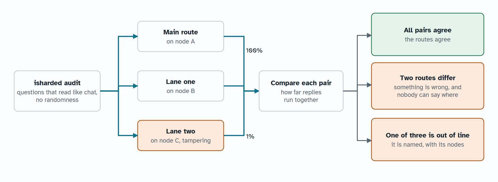
</picture>

The 100% and 1% on the picture are what was measured, as described below. Load the same model again on other machines, then ask:

```bash
isharded load Qwen3-0.6B-Q8_0.gguf --lane check --lane-apart --url http://node-a:8209
```

```bash
isharded audit --url http://node-a:8209
```

With two routes, a disagreement says something is wrong without saying where. With three or more, the route out of line with the others is named, along with the machines it runs on. What you do about that is yours: cordon or revoke it in an owned network, or `isharded net block` it for your own node in one nobody owns.

Agreement is how far two replies run together word by word, as a share of the shorter one, and the median across the questions. Under 50% counts as disagreeing, because hardware rounds differently and honest routes can part at a close call. The last result is in `/admin/status` as `last_audit`, and a disagreement also shows in the dashboard's events.

The questions are made up and look like ordinary chat, so nobody's real words travel anywhere extra, and a node cannot easily tell it is being tested. This is a smoke alarm, not a proof. It catches a stage that is broken, or that tampers with what it handles. It does not catch one that behaves whenever it might be watched, or that only touches certain topics. It costs a second copy of the model, which a large mesh can spare and a small one may not.

Measured on three nodes on one Linux machine, each route on its own node, with Qwen3-0.6B Q8_0 and 6 questions. Honest routes agreed 100%. With one node tampering with its logits, its route agreed 1% with the others, and it was named along with its node. All 13 checks of that run passed. Every route ran on the same machine, so this does not show how far honest routes part on different hardware.

## Running a pool

The full guide is [Operating iSharded](OPERATIONS.md).

**Start at boot.** A node started with `isharded up` needs only `isharded service install`, which starts it when you log in. To start at boot instead, on Windows, `scripts\install_node_task.ps1` registers a scheduled task. On Linux, use `packaging/isharded-node.service`, which has not been run on a real machine yet. A node restarts its own services, so these only have to start it once.

**Maintenance.** `isharded cordon NAME` lets replies finish and moves that node's layers away. The node stays in the mesh. `isharded uncordon NAME` brings it back. A cordon is shared by every node and survives restarts. It is refused if the pool could not hold the model without that node, and if it would transfer over 2 GiB, unless you add `--force`.

**Upgrades.** Nodes refuse peers on a different `PROTOCOL_VERSION`, and the refusal names both versions. Upgrade all nodes together when that number changes. Otherwise, restart them one at a time, and the mesh carries on around each one.

**Backups.** Keep the authority folder safe and offline. Losing `ca.key` means reissuing every certificate, and anyone who gets it controls the pool. Route state is copied to every node, so it needs no backup.

**Files.**

| What | Where | Notes |
|---|---|---|
| Route state | `orchestrator-state.json` in the state folder | Copied to every node by gossip |
| Keys and revocations | `access.json` in the iSharded folder | Copied to every node by gossip |
| Audit log | `audit.jsonl` in the state folder | Rotates at 64 MiB, keeping one old file. Each node logs only what it served |
| Node log | `--log-file` | Nothing is kept unless you set this |
| Fetched shards | `--cache-dir` | Evicted past `--cache-budget-gb` |
| Stage files | Inside the cache | Rebuilt from shards when a stage moves. Count double the node's share |
| Saved prompt states | `states` inside the cache | People's conversations, unencrypted, readable only by the node's own user. Evicted past `--state-disk-gb`, and deleted when the model or the stage's layers change |

A node started with `isharded up` keeps its route state, keys, and audit log in its own folder instead, along with its log, `node.log`.

**Metrics.** `/metrics` serves Prometheus format on every node, to an admin key. All names start with `isharded_`.

| Metric | Meaning |
|---|---|
| `serving` | Whether this node can serve replies. Alert at 0 |
| `workers_quarantined` | Workers held out of the route. Alert above 0 |
| `workers_live`, `worker_live` | Workers heard from recently, overall and per worker |
| `mesh_members` | Control planes reachable from here. Alert below the node count |
| `mesh_term`, `coordinator`, `epoch` | Leadership term, whether this node coordinates, and the pipeline epoch |
| `stream_fallbacks_total` | Replies whose stream failed, and that resumed or fell back to replay. Should stay near zero, because fallbacks hide trouble |
| `stage_errors_total` | Requests a stage refused. Nobody is quarantined for these, so a real fault shows here |
| `stage_restarts_total`, `worker_stage_restarts_total` | Replays after a stage restart, and stage processes restarted |
| `recoveries_total` | Pipeline repairs during a reply |
| `requests_total`, `tokens_generated_total`, `embedding_tokens_total`, `replies_in_flight` | Traffic through this node |
| `token_latency_ms`, `worker_compute_ms` | Time per token, and compute per pass |
| `worker_stages_kept_total` | Reconfigures that moved no weights |
| `worker_draft_tokens_per_pass` | Tokens per speculative pass. Near 1 means the draft is not helping |
| `worker_pipeline_tokens` | Tokens made with passes overlapping on the route |
| `worker_pipeline_misses` | Guesses that sent a pipeline back |
| `prompt_tokens_computed_total`, `prompt_tokens_reused_total` | Prompt tokens the route computed, and restored instead. This is the saving: the second over the sum of both. `metrics.cache` in `/admin/status` gives it as `saved_percent` |
| `worker_prompt_tokens_computed_total` | Prompt tokens a stage computed |
| `worker_tokens_reused_total` | Prompt tokens a stage restored instead of computing. `source` is `prefix` for a shared prefix or `history` for a conversation, then the tier it came from |
| `worker_state_misses_total` | Saved states a stage did not hold when asked. Each costs a reread, and nothing else |
| `worker_cache_bytes` | Bytes of saved state a stage holds, by `tier`: `ram`, `disk`, or `held` for copies kept for other stages |
| `worker_state_copy_bytes_total` | Bytes of state copied to another node |
| `worker_state_copies_failed_total`, `worker_state_copies_dropped_total` | Copies that did not arrive, and copies dropped behind a newer one or a full queue. Neither touches a reply. They mean recovery may reread more |

## Troubleshooting

| What you see | Cause | What to do |
|---|---|---|
| `reachable by other machines and this pool has no credentials` | No token or authority on a node listening on the network | Run `isharded pool init`, or pass `--open` on a network you trust completely |
| `would carry the pool's credentials unencrypted` | The node would send credentials across a plain network | Use Tailscale or TLS, or pass `--trusted-network` |
| The chat page keeps asking for a token | A wrong key, or a pool token in a pool with certificates | Use an API key. With certificates, the pool token does nothing |
| `no model is ready; load one first` | Nothing is loaded, or a load outlasted the 10 minutes a reply waits for it | Load a model, or check progress on the dashboard |
| `isharded load` cannot connect | It assumes the demo's port | Pass `--url http://NODE:8209` |
| A node shows as standby | Its share moved away after a failure, and the model still fits without it | `POST /admin/rebalance` when you want the layout back. It returns by itself when idle |
| `failed to load, and replanning would move` | A live node could not load its stage, and moving its share would be large | Read the error after the colon. The old model keeps serving meanwhile |
| `no node could send bytes` | A peer transfer failed after retries. The message ends with the reason | Check the link, and that the node holding the file is up |
| `CERTIFICATE_VERIFY_FAILED`, or an event mentioning antivirus | Something replaced a certificate | Exclude the pool's ports from scanning, or use tickets over Tailscale |
| A node reports HTTP 426 | Nodes are on different versions | Upgrade them together |
| The ROCm build sees no GPU | `hipblas.dll` is missing | Use the node's PyTorch ROCm environment, which carries it |
| Far slower than usual | VRAM spilled to shared memory, or a stray process holds the GPU | Check GPU memory per process. A stage with a large "shared" figure needs a reload |
| A reply went quiet | A stage or link is stuck | Read `GET /internal/diag/tasks` on each node to see what everything is waiting on |
| `the rest of the pool cannot hold this model` | A cordon would leave nowhere for that node's layers | Add memory, or load a smaller model first |
| A node's events say `No native engine` or `Native path off` | The node has no engine, so its replies use the slower Python path | `isharded doctor` says why. See [The native engine](#the-native-engine) |
| `libgomp.so.1: cannot open shared object file` | A minimal Linux install lacks a library llama.cpp needs | `sudo apt-get install libgomp1` |
| A browser warns about the certificate | `isharded up` used TLS with the mesh's own certificate, off Tailscale | Accept it once, or use Tailscale, which needs no warning |
| `nobody signed this request` | The owner's machine is off, or the invite ran out | Start `isharded up` on the owner's machine, and make a new invite |
| `is not the mesh this invite is for` | The address in the invite answers with a different mesh | Stop, and ask the owner for a new code. Something else is at that address |
| `another machine already uses the name` | Two machines have the same name | Run `isharded up --invite CODE --name another-name` |
| `This machine already belongs to a mesh` | `isharded up` has settings from an earlier mesh | Remove the folder it names to join another |
| A new machine does not find the mesh | A firewall blocks UDP port 8208, or the mesh was started with `--no-discovery` | Use `isharded invite` |
| `only the machine that made this mesh can invite` | The authority's key is on the owner's machine | Run `isharded invite` or open the page there |
| A lane stays on `starting` | A firewall blocks its ports, which are 1000 per lane above the node's own | Open them between nodes, then remove the lane and load it again |
| `no node has memory left under the limits its owner set` | The main model uses all that owners gave | Give nodes more with `--gpu-memory-gb` or `--weights-ram-gb`, or load a smaller main model |
| In a network nobody owns, a node never appears | The others do not accept it yet | Have a node they accept run `isharded net vouch`, or use `--joining open` |
| `nobody can replace what this network runs` | In a network nobody owns, the running model stays | Load yours beside it with `--lane` |
| `this model's chat template has no tool format` | The template shows no way of calling tools, or one iSharded cannot read | Send `tool_choice: "none"`, or load a model the [table](#tool-calling) lists |
| `does not fit the model's chat template` | The template refused the conversation. The message ends with its reason, such as parallel calls on Llama | Change the conversation to suit the model |
| A tool call comes back as text | The model wrote something that is not a call to an offered tool | Read `content` to see what it wrote. Small models do this often, so retry or use a larger one |
| A model answers without calling a tool | `auto` leaves that to the model | Send `tool_choice: "required"` |
| `isharded mcp run` says `Refused`, with no question | There is no terminal to ask at | Name the tool with `--allow` |
| `isharded mcp run` says the reply was cut off | The model reached the token limit on its last turn | Raise `--max-tokens`, or ask for less |
| An MCP server cannot find a key or setting | Servers see only a short list of environment variables | Pass it with `--pass-env` |
| `isharded up --model` says `Could not load`, and `this needs the member role` | An invited machine holds a user key, and loading needs an admin key | Load it from the owner's machine |
| `checking needs two routes` | `isharded audit` found one route for that model | Load another with `--lane NAME --lane-apart` |
| Nodes on one Windows machine all lose contact at once | An antivirus network filter may be stalling loopback HTTP | See [below](#nodes-on-one-windows-machine-failing-together) |

### Nodes on one Windows machine failing together

An antivirus network filter can stall loopback HTTP when many local processes connect. Measured with AVG on Windows 11: an idle local server took up to 20 s to answer, on a 10 s grid, while CPU stayed under 80% and a 1 s timer never slipped past 1.4 s. Nodes on that machine all "lost contact" at once, and the same test on Linux showed no reply over 0.18 s.

So several nodes on one Windows machine with such a filter can look like they are failing together. Between machines it was not seen.

## Measured performance

Qwen3.6-27B Q4_K_M, split across an RX 7900 XT desktop and an RTX 3060 laptop, both on Wi-Fi with a 15 ms ping:

| Setup | Tokens per second |
|---|---:|
| Desktop alone, llama.cpp, no split (ceiling) | 35.2 |
| Both nodes, llama.cpp's own RPC, whole file on one node | 13.6 |
| Both nodes, iSharded, no draft | 14.6 |
| Both nodes, iSharded with a draft, prose and lists | 19–21 |
| Both nodes, iSharded with a draft, code | 33 |
| Both nodes, iSharded with a draft, chat page settings, four-turn chat | 21.6 |

Models that need or suit the split, on the same test pool:

| Model | Placement | Tokens per second |
|---|---|---:|
| Qwen3.8-27B Q8_0, 26.6 GiB, too big for either machine | Desktop 14 GiB VRAM + 3.9 GiB RAM, laptop 3.1 GiB VRAM + 5.7 GiB RAM | 4.2–6.7 |
| Qwen3.6-35B-A3B IQ2_XXS, a MoE with 256 experts | Laptop 1.2 GiB VRAM, desktop 8.8 GiB VRAM | 27 for one conversation, 48 in total for three |

A 1,860-token first message took about 6.5 s to the first token. Later turns of that chat took 0.7 to 1.3 s, with over 2,000 tokens of history behind them. Downloads share the link: chat dropped to about 5 tokens per second while a new model downloaded over the desktop's Wi-Fi.

Reusing prompts, on Qwen3-0.6B Q8_0 over two stages on CPU, all on one machine, with a system prompt of 1,326 tokens. Each cell is time, then prompt tokens computed. For failures, the time is the longest pause in the reply:

| | Before | After |
|---|---:|---:|
| First conversation with a system prompt | 10.9 s, 1,354 | 10.9 s, 1,354 |
| Later conversations with the same system prompt | 10.7 s, 1,354 | 1.0 s, 28 |
| A conversation back after being pushed out | 11.1 s, 1,420 | 1.2 s, 77 |
| The next turn of a conversation | 1.3 s, 51 | 1.3 s, 86 |
| A stage process killed | 12.0 s, 1,414 | 2.6 s, 149 |
| A node restarted | 19.8 s, 2,820 | 10.9 s, 149 |
| A node killed, with a spare | 36.4 s, 1,414 | 23.5 s, 149 |
| A link gone silent, with a spare | 31.9 s, 1,414 | 22.5 s, 149 |
| A node killed, with no spare | 44.2 s, 1,414 | 36.0 s, 1,475 |

With the cache on and off, 48 of 48 replies were the same on this model at temperature 0, and 19 of 19 on Qwen3.5-0.8B, with images and with a draft. That was one reply at a time, on one route, on CPU. Four conversations over two sequences, with a stage killed among them, finished all 24 replies on each model.

Planner estimates leave out the draft and are rough. The figures above were measured. For failure timings, see [What happens when something fails](#what-happens-when-something-fails).

## Development

```bash
python -m pip install -e ".[test]"
```

```bash
python -m pytest tests -q
```

The last full run on Windows passed 3,474 tests and skipped 21, with real models for text, embeddings, and vision. From a clean clone on Linux, with the current FastAPI, 3,451 passed and 40 skipped.

Adapter tests compare every family with the reference `transformers` implementation, and skip families newer than the installed release, so run them under a current `transformers` as well. TLS tests skip on a machine where antivirus intercepts loopback. `tests/test_readme.py` fails if an option, setting, endpoint, or metric is missing from this file, and `tests/test_assistant_docs.py` does the same for the assistant's guide. `tests/test_mcp.py` also tries the official `mcp` package when `ISHARDED_TEST_MCP_PYTHON` names a Python that has it, and uses port 9531.

`scripts/ci_local.sh` runs what CI runs from a clean clone, which catches anything only your machine has.

| Script | What it does |
|---|---|
| `install.sh`, `install.ps1` | Install for one user, with nothing needed first, and start the node |
| `scripts/build_engine.py` | Builds the native engine |
| `scripts/build_wheel.py` | Builds a wheel, with the engine in it or without |
| `packaging/windows/isharded.iss` | The Windows installer, built with Inno Setup |
| `packaging/macos/build_pkg.sh` | Builds the macOS package. Needs macOS |
| `packaging/linux/build_deb.sh` | Builds the Debian package |
| `scripts/build_tiny_model.py` | Builds the offline test model |
| `scripts/verify_model.py` | Compares a running checkpoint with an unsharded reference |
| `scripts/build_diagrams.py` | Redraws the diagrams in this file |
| `scripts/build_countries.py` | Rebuilds the country table from the registries' files |
| `scripts/build_flags.py` | Rebuilds the dashboard's flags. Needs Node |
| `scripts/ci_local.sh` | Runs the tests from a clean clone |
| `scripts/install_node_task.ps1` | Starts a node at boot on Windows |

| Code | What it holds |
|---|---|
| `isharded/cli.py` | The `isharded` command |
| `isharded/orchestrator.py` | The control plane: API, planning, repair, gossip handling |
| `isharded/replies.py` | The OpenAI reply shapes: streaming events, usage, rendered prompts |
| `isharded/worker.py` | A worker: stages, the token loop, merged passes, fetching |
| `isharded/pipeline.py` | Keeps every stage busy on one reply: overlapping passes and wrong guesses |
| `isharded/engine.py` | Loads the native engine, and speaks to it from the worker |
| `engine/` | The native engine in Rust: stage links, token passes, sampling |
| `isharded/up.py`, `isharded/discovery.py` | One-command setup: settings, invites, finding a mesh, `doctor`, and `service` |
| `isharded/node.py` | The launcher that supervises a node's services |
| `isharded/lanes.py` | Several models at once: the front door and each node's lanes |
| `isharded/toolcalls.py` | Tool calling: what a template offers, and finding calls in replies |
| `isharded/mcp_server.py`, `isharded/mcp_client.py` | The mesh as an MCP server, and the agent loop and MCP client for `isharded mcp run` |
| `isharded/embedding.py` | Packing text into embedding passes, and turning pooled output into vectors |
| `isharded/vision.py`, `isharded/mtmd.py` | Images in chat, and the binding to llama.cpp's `mtmd` library |
| `isharded/commons.py` | A network nobody owns: self-made identities, vouches, and each node's view |
| `isharded/inventory.py`, `isharded/gpu_probe.py` | What a node reports about itself, and how it finds GPUs PyTorch cannot see |
| `isharded/audit.py` | Comparing routes that serve the same model |
| `isharded/mesh.py` | Membership and leader election, as pure logic |
| `isharded/planner.py`, `isharded/memory.py` | Placement, and memory pool discovery |
| `isharded/protocol.py`, `isharded/slots.py` | What nodes and clients send, and who gets a place in a pipeline |
| `isharded/tokenizer.py` | Tokenizing and chat templates |
| `isharded/serving.py` | The HTTP server's limits and diagnostics |
| `isharded/models/` | Each model family's forward pass, for safetensors models, and the GGUF model description |
| `isharded/gguf.py`, `isharded/gguf_stage.py`, `isharded/llamacpp.py`, `isharded/llama_host.py` | GGUF parsing, stage files, the llama.cpp binding, and the stage process |
| `isharded/statestore.py`, `isharded/statecopy.py` | Saved prompt states, where prompts are cut, and the copy of each on another node |
| `isharded/weights.py` | Readers, the unit cache, and hash checks |
| `isharded/access.py`, `isharded/pool.py`, `isharded/tickets.py`, `isharded/tls.py`, `isharded/statements.py` | Keys, certificates, signed entries, tickets, TLS, and proving who asked when a request is passed on |
| `isharded/chat.html`, `isharded/dashboard.html`, `isharded/ui.css` | The chat page and the dashboard |
| `isharded/assistant/` | The assistant. [Its guide](ASSISTANT.md) says which part does what |

## Current limits

Trust and status:

- Seven machines is the most this has run on, for about two hours, so everything about larger meshes is design, not measurement. See [Scaling to many nodes](#scaling-to-many-nodes). The longest continuous soak ran under an hour. No human has audited it, and reviews by AI do not show it is free of flaws.
- A node in the route can read prompts. It can return wrong answers too: [checking answers](#checking-answers) catches a route that disagrees with others, but not one that only misbehaves when it is not being tested, and it has been measured only with every route on one machine. Certificates limit who is in a pool. They do not make a hostile member safe.
- The [native engine](#the-native-engine) is new. Macs with Intel chips, and Linux without glibc 2.28, get no wheel with it. Its direct links have known gaps: a closing link that goes silent can hold a reply for minutes before it replays; a stage that hangs without dying takes minutes to notice; and a route's stages share one key, so one stage can forge another's answers. Use it only among nodes you trust.
- An owned network has an owner.
- A network nobody owns passed 27 of 27 checks on real processes, but as three nodes on one machine, not between strangers. Identities are free, so `--joining open` lets one person run many nodes, and a low name can be ground out to win coordination. A coordinator can stall a route. Traffic is not encrypted, so run it over a network that is, such as Tailscale. Use `--joining vouched` with a quorum unless you accept all of that.
- Several models run in lanes with fixed memory shares, and each lane adds two processes to a node. The main model's planner does not see a lane's memory, so moving layers after a failure can run a node short. Workers started with `--no-control` do not join lanes.
- GitHub Actions runs the tests on Linux and Windows for every push. Those jobs run on CPU, so real GPU runs are measured by hand.
- Linux GPUs have run real nodes on rented A40 machines. macOS has not run a real model yet, although its builds are pinned and download by themselves.
- Adding a machine with an invite needs the owner's machine running at that moment. The mesh keeps working without it.

Behavior:

- A text prompt goes out in parts, so stages read it at the same time. A prompt with images still crosses the stages whole, one stage after another.
- Hybrid Qwen models on the PyTorch path process prompts token by token. This is exact, but slower than a chunked kernel on long prompts.
- Long-context rope scaling (YaRN) and sliding-window attention are refused rather than run incorrectly.
- Expert placement is per layer, not per expert: frequently used experts are not promoted to faster memory.
- The planner does not reserve VRAM for a draft model. It loads into what is left on the entry node, and if it does not fit the model runs without it.
- The planner does not count the snapshots a recurrent model keeps while guessing: up to `draft_tokens` + 2 copies of a stage's recurrent state for each slot, in RAM.
- Multi-token batches cross between GGUF stages as BF16, and single tokens as FP32. A node set to `--dtype float32` keeps everything in FP32.
- A stage file duplicates that node's cached units on disk.
- GGUF files are parsed by native code in the stage process, so load them only from sources you trust.
- Outside embedding mode, llama.cpp's operation offload stays on, so a stage with no GPU layers may still use a GPU the build can reach for prompts of 32 tokens or more.
- The planner uses measured memory bandwidth and a fixed cost per network hop, but not per-layer benchmarks or pairwise network telemetry. Its disk estimate assumes cold reads, so warm runs beat it.
- Workers on one host split shared RAM evenly during planning, which can refuse a plan an uneven split would allow.
- There is one active RAM checkpoint service per route, for PyTorch models. Snapshots are not yet replicated or compressed. If the store is behind when a stage fails, recovery replays the prompt.
- Cutting prompts into the same passes every time has a cost. A long chat of short messages, read with nothing saved, runs as many small passes: 1,770 tokens in 49 messages took 17.6 s where it took 13.5 s before, on CPU. Prompts with few turns cost the same as before. Turns under 64 tokens can also reread up to 64 tokens more than the last turn did.
- A saved state is only good for the layers it came from. If a node is lost with no spare, the survivors split the layers differently and the prompt is read in full, with or without copies.
- A different split of the layers can change a near-tie at temperature 0, because rows round to BF16 at each stage boundary. So a reply is the same with the cache on or off for a given split, and not across splits.
- A GGUF reply that recovers from a failure reads its prompt as usual, then runs each token it already wrote as its own one-row pass, as plain decoding did. So it carries on exactly while its layers stay where they were. With a stage process killed mid-reply on three local stages of Qwen3-0.6B, 26 of 26 replies matched an unbroken run, greedy and seeded, with direct links and without. Reading back as prompt rows had changed 10 of 11. This has not run on a real mesh, with a draft model, or with other replies running beside it.
- A recovered reply can still differ from an unbroken run at a near-tie in these cases. A prompt with images, or a PyTorch model, still reads the reply back as prompt rows. A reply that moved to other layers meets the limit above. A reply a draft checked several rows at a time had those tokens rounded differently the first time, and so did one that shared merged passes with other conversations.
- Recovery costs one pass for each token already written. A failed stage takes the direct links down, so those passes usually run over HTTP, one at a time. On the same local stages that took 21 ms a token, and 4.7 ms on direct links, where they go 16 at a time. On a slow route a long reply takes much longer to resume than the one batched pass did.
- Copies of saved states are sent whole on every turn, so a long conversation on a slow link falls behind. Recovery then uses an older state, or none.
- Saved states are not deleted when a conversation ends, and are stored unencrypted. See [the security notes](SECURITY.md#saved-conversations).
- With two nodes, a split network leaves two coordinators until it heals. Nothing can be corrupted, but neither side can know it is the minority.
- A reply is lost if the node its client is connected to dies.
- Mesh membership is meant for tens of nodes: every worker checks in with every control plane.
- Tool arguments are not constrained to a schema, even for a forced call. Only the start of a call is forced, and a client should check what it receives.
- A streamed tool call arrives once it is complete, not token by token.
- Llama, Mistral, and Hermes calls are read and rendered correctly as far as their real templates show, but no such model can load on a mesh yet, so none has run here.
